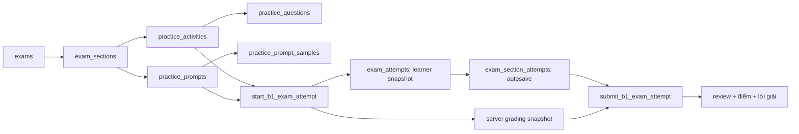

# B1 Exam: Hiện trạng ba trang học viên và kiến trúc quản trị nội dung

**Ngày:** 2026-07-28
**Trạng thái:** Tài liệu thiết kế cho phase quản trị nội dung đề thi
**Đối tượng:** Product, UX, frontend, backend và quản trị viên nội dung

## 1. Mục đích

Tài liệu này ghi nhận đầy đủ những gì đã triển khai ở ba màn hình học viên của bài thi B1:

1. `/app/exams` — trang đề thi, thiết lập thời gian và lịch sử.
2. `/app/exams/attempt/:attemptId` — trang làm bài.
3. `/app/exams/attempt/:attemptId/result` — trang đáp án và kết quả.

Từ hiện trạng đó, tài liệu xác định kiến trúc cần có cho trang quản trị: admin không chọn UI theo tên section, `source_key` hay chỉ theo kỹ năng; admin chọn một **dạng trình bày** (presentation type) có kiểm soát. Dạng trình bày quyết định editor của admin, trải nghiệm làm bài, cách chấm, trải nghiệm xem đáp án và yêu cầu dữ liệu.

Mô hình này giải quyết việc cùng một kỹ năng có nhiều hình thức rất khác nhau:

- Reading có thể là đoạn đọc + trắc nghiệm, cloze trong đoạn, hoặc câu hỏi ngắn.
- Listening có thể là audio + chọn đáp án, audio + điền vào chỗ trống, hoặc ghép cặp.
- Writing có thể là viết lại câu hoặc viết một bài/đoạn văn dài.
- Speaking hiện là chuẩn bị script, nhưng sau này có thể thêm ghi âm và chấm theo rubric.

## 2. Nguyên tắc thiết kế

| Nguyên tắc | Ý nghĩa thực thi |
| --- | --- |
| Kỹ năng không phải UI | `listening`, `reading`, `writing` mô tả mục tiêu học tập; chúng không đủ để quyết định giao diện. |
| Presentation type là hợp đồng | Một type định nghĩa editor admin, renderer làm bài, renderer kết quả, schema nội dung, validation và cách chấm hợp lệ. |
| Dữ liệu nguồn khác snapshot | Admin sửa resource nguồn. Lần làm bài luôn đọc snapshot đã đóng băng lúc bắt đầu, nên sửa đề không làm thay đổi bài đang làm hoặc kết quả cũ. |
| Đáp án chỉ xuất hiện sau nộp | Snapshot phía học viên không có đáp án đúng; server giữ dữ liệu chấm riêng và trả review sau `submit`. |
| Không dùng form kỹ thuật | Admin nhập bằng editor trực quan, media picker, các trường có nhãn và preview; không nhập JSON/HTML/SQL thô. |
| Khả năng mở rộng có kiểm soát | Thêm dạng mới là thêm một presentation type và các renderer/editor bắt buộc, không thêm chuỗi `if (source_key === ...)`. |

## 3. Hiện trạng dữ liệu và luồng bảo toàn bài làm



### 3.1. Resource hiện có

- `exams`: catalog đề, cấp độ, thời lượng mặc định, trạng thái xuất bản.
- `exam_sections`: thứ tự phần thi, kỹ năng, resource được liên kết, có bắt buộc hay không.
- `practice_activities`: resource objective cho Grammar, Signs, Reading, Cloze, Transformation và Listening.
- `practice_questions`: câu hỏi, lựa chọn, đáp án chấp nhận, bản dịch, lời giải, ảnh.
- `practice_prompts`: đề Writing/Speaking, hướng dẫn, ảnh/audio.
- `practice_prompt_samples`: nhiều bài mẫu cho một prompt để người học so sánh.
- `exam_attempts` và `exam_section_attempts`: timer chung, trạng thái, dữ liệu đã autosave, draft và điểm từng phần.
- `practice_draft_versions`: các phiên bản Writing/Speaking bất biến, tối đa năm phiên bản trên một prompt.

### 3.2. Metadata presentation đã có

Mỗi `practice_activities` và `practice_prompts` đã có các trường sau:

| Trường | Vai trò |
| --- | --- |
| `presentation_type` | Dạng UI/UX được chọn. |
| `grading_mode` | Cách chấm tương thích với presentation type. |
| `content_schema_version` | Phiên bản schema để có thể migrate dữ liệu an toàn. |
| `content_blocks` | Nội dung có cấu trúc, ví dụ text và các gap trong passage. |
| `presentation_config` | Cấu hình hiển thị riêng cho renderer. |
| `review_config` | Cấu hình phần review sau khi nộp. |

RPC bắt đầu bài đã snapshot toàn bộ metadata này nhưng loại bỏ đáp án đúng khỏi snapshot học viên. Điều này là nền tảng đúng để admin có thể sửa đề mới mà không phá bài cũ.

## 4. Trang 1 — Trang đề thi `/app/exams`

### 4.1. Những gì người học đang làm được

| Khu vực | Hành vi đã có |
| --- | --- |
| Thiết lập thời gian | Có preset thời lượng, thời lượng tự nhập 1–480 phút và phần gợi ý phân bổ thời gian giữa Grammar/Reading, Listening, Writing/Speaking. |
| Danh sách đề | Hiển thị đề đã publish, tìm kiếm, lọc Free/Pro, thông tin cấp độ và kỹ năng. |
| Bắt đầu đề | Tạo attempt qua RPC với thời lượng người học đã chọn, sau đó vào trang attempt. |
| Lịch sử | Tách bài đang làm dở và bài đã nộp. |
| Bài đang làm dở | Có tiến độ thời gian, nút tiếp tục và nút đóng bài thi dùng modal xác nhận. Đóng attempt không xóa draft Writing/Speaking. |
| Bài đã hoàn thành | Hiển thị thời gian làm, overtime và nút **Xem kết quả** dẫn đến đúng trang result. |

### 4.2. Vai trò của trang này trong kiến trúc admin

Trang catalog không nên tự suy diễn các kỹ năng từ UI cố định. Khi builder hoàn thiện, card đề nên đọc summary từ sections thực tế: số phần theo kỹ năng, tổng câu objective, các phần có audio, trạng thái đầy đủ nội dung và cảnh báo publish. Đây là summary phục vụ người học; admin quản lý chi tiết ở builder.

## 5. Trang 2 — Trang làm bài `/app/exams/attempt/:attemptId`

### 5.1. Khung trải nghiệm chung đã có

| Thành phần | Hành vi đã triển khai |
| --- | --- |
| Header sticky | Tên đề, section hiện tại, trạng thái autosave, số câu đã làm/tổng câu, timer chung. |
| Timer | Đếm ngược theo thời lượng đã chọn; hết giờ chuyển sang overtime, cảnh báo đỏ nhưng vẫn cho tiếp tục làm và nộp. |
| Điều hướng section | Sidebar liệt kê toàn bộ section, trạng thái hoàn thành và số câu đã trả lời. Chuyển section cuộn mượt lên đầu. |
| Điều hướng câu hỏi | Có grid nhảy nhanh tới câu objective; các ô đã trả lời được đánh dấu. |
| Lưu dữ liệu | Câu objective autosave sau khi thao tác dừng ngắn; Writing/Speaking autosave nội dung, đồng thời cho tạo version checkpoint. |
| Audio | Nếu resource có `audio_url`, hiện audio player ở đầu phần thi. |
| Nộp bài | Có modal xác nhận. Hệ thống lưu phần hiện tại, submit server-side, khóa bài làm và chuyển thẳng tới trang kết quả. |

### 5.2. Các presentation hiện đang được renderer hỗ trợ

| Dạng nội dung | Cách làm bài hiện có | Dữ liệu chính |
| --- | --- | --- |
| Chọn một đáp án | Danh sách câu hỏi với các lựa chọn; áp dụng cho Grammar, Listening, Reading và Signs. | `questions[].options` |
| Đúng/Sai | Cùng nền tảng lựa chọn nhưng chỉ có hai đáp án. | `questions[].options` |
| Image/Signs + lựa chọn | Hiển thị ảnh khi câu có `image_url`, sau đó chọn đáp án. | `image_url`, `options` |
| Passage + câu hỏi | Passage nằm trên, các câu hỏi lựa chọn nằm dưới. | `passage`, `questions` |
| Điền từ trong đoạn | Ô input được đặt ngay trong passage; từng gap lưu theo source key. Repeated reference chỉ hiển thị giá trị đã nhập, không tạo input trùng, nên không còn lỗi gõ một chỗ điền cả hai. Nhấn Enter chuyển focus tới câu tiếp theo. | `content_blocks` hoặc legacy marker `(n) ____` |
| Chọn đáp án trong đoạn | Đã có metadata/type, nhưng renderer cần được tách thành component riêng thay vì còn dựa nhiều vào nhánh legacy. | gap + options |
| Viết lại câu | Câu gốc, keyword, prefix/suffix và ô nhập; Enter chuyển tới câu kế. | prompt có cấu trúc/legacy parse, `accepted_answers` |
| Writing | Chỉ hiển thị đề/hướng dẫn; người học tự viết vào nội dung lớn, autosave và tạo tối đa năm version. | `practice_prompt`, draft versions |
| Speaking script | Cùng cơ chế draft như Writing, mục tiêu là hoàn thiện văn bản bài nói trước khi luyện nói. | `practice_prompt`, draft versions |

### 5.3. Điểm cần chuẩn hóa tiếp

- Các renderer hiện vẫn nằm tập trung trong `ExamAttemptPage`; cần tách theo type để mỗi type có component riêng, test riêng và UI nhất quán.
- `matching`, `ordering`, `short_answer_list` đã có trong registry nhưng chưa có learner renderer hoàn chỉnh.
- Với `passage_choice_inline`, lựa chọn tại từng gap cần có UI rõ ràng (dropdown/card nhỏ) thay vì tái sử dụng nhánh text-gap.
- Cấu hình hành vi như số lần phát audio, shuffle lựa chọn, số từ gợi ý hay giới hạn từ phải nằm ở `presentation_config`, không hard-code trong page.

## 6. Trang 3 — Trang đáp án `/app/exams/attempt/:attemptId/result`

### 6.1. Những gì đã có

| Khu vực | Hành vi đã triển khai |
| --- | --- |
| Bảo vệ route | Attempt chưa nộp không xem được result. |
| Tổng quan | Hiển thị điểm, điểm tối đa, thời gian làm và overtime. |
| Nhóm theo phần | Kết quả được nhóm rõ theo section/skill thay vì trộn toàn bộ câu. |
| Trắc nghiệm | Đáp án người học chọn sai có nền đỏ; đáp án đúng có nền vàng. Không còn chỉ hiển thị đáp án đúng khiến người học không biết mình đã chọn gì. |
| Nội dung đáp án | Khi dữ liệu lựa chọn có text, result hiển thị nội dung đáp án, không chỉ A/B/C/D. |
| Cloze/inline gap | Đáp án được chèn trực tiếp vào đoạn văn. Câu sai hiện cả câu trả lời người học và đáp án đúng bằng nội dung thực. |
| Viết lại câu | Chấm normalized text: khác dấu câu/line break đơn thuần không bị xem là sai; khác chữ/từ vẫn bị xác định. UI giữ từ liền mạch, highlight theo token/ký tự và gạch chân hạ thấp để không cắt đuôi `g`, `y`. |
| Dịch và lời giải | Nếu có trên `practice_questions`, hiển thị ở từng review objective. |
| Writing/Speaking đã nộp | Hiển thị lại bản nháp đã nộp của section. |
| So sánh Writing | Lấy bài mẫu của prompt, so sánh nội dung và highlight phần khác. Chuẩn hóa dấu chấm, dấu phẩy và xuống dòng trước khi so khớp để khác định dạng không bị coi là khác nội dung. |
| Làm lại | Tạo attempt mới; timer và trạng thái nộp được reset, nút nộp không còn bị khóa. |

### 6.2. Những điểm cần hoàn thiện trong phase renderer

- Result phải lấy logic hiển thị từ component cùng presentation type với attempt, tránh việc cùng một dạng có hai parser khác nhau.
- `review_config` cần quy định rõ: hiện/ẩn đáp án đúng, hiện lời giải, hiện dịch, quy tắc highlight, rubric tự luận và bài mẫu mặc định.
- Với Writing/Speaking cần tách rõ ba loại review: bản nộp trong attempt, version history của người học và bài mẫu do admin xuất bản.
- Matching/ordering/short answer chưa có UI review chuyên biệt.

## 7. Registry presentation type — hợp đồng bắt buộc cho admin

Registry hiện có 12 type. Bảng sau là phạm vi thiết kế chuẩn; cột “trạng thái” cho biết cần làm gì tiếp theo.

| Presentation type | Skill phù hợp | Editor admin cần có | UI người học | Review/chấm | Trạng thái |
| --- | --- | --- | --- | --- | --- |
| `choice_list` | Grammar, Reading, Listening | Câu hỏi, lựa chọn, đáp án đúng, dịch, lời giải | Danh sách trắc nghiệm | `single_choice`, đỏ/sai + vàng/đúng | Đã có lõi |
| `boolean_list` | Reading, Listening | Câu hỏi đúng/sai | Hai lựa chọn | `single_choice` | Đã có lõi |
| `image_choice_list` | Signs | Image picker, alt text, lựa chọn | Ảnh + trắc nghiệm | `single_choice` | Đã có lõi, cần media picker |
| `passage_questions` | Reading | Rich passage + danh sách câu hỏi | Đoạn văn trên, câu dưới | `single_choice` | Đã có lõi |
| `passage_text_inline` | Cloze, Listening | Passage composer + gap + đáp án chấp nhận | Input ngay trong đoạn | `exact_text`/`normalized_text` | Đã có lõi |
| `passage_choice_inline` | Cloze, Reading | Passage composer + gap + lựa chọn mỗi gap | Chọn đáp án tại gap | `single_choice` | Schema có, cần renderer chuyên biệt |
| `sentence_transformation` | Writing/Use of English | Câu gốc, keyword, prefix, suffix, đáp án, dịch, lời giải | Câu hỏi trên, ô viết lại dưới | normalized/exact text, highlight token | Đã có lõi |
| `short_answer_list` | Listening, Reading | Danh sách câu trả lời ngắn | Input từng câu | exact/normalized text | Chưa có renderer/editor riêng |
| `long_form_prompt` | Writing | Prompt, hướng dẫn, word range, bài mẫu, audio/TTS | Text editor, autosave/version | manual/sample compare | Đã có editor/draft lõi; thiếu CRUD mẫu/media/preview |
| `speaking_script_prompt` | Speaking | Prompt, chuẩn bị, rubric, mẫu script, audio/TTS | Text editor/script version | manual/sample compare | Đã có editor/draft lõi; thiếu CRUD mẫu/media/preview |
| `matching` | Vocabulary, Listening, Reading | Hai danh sách, mapping đúng, shuffle | Ghép cặp trực quan | `matching` | Registry mới; chưa có renderer |
| `ordering` | Writing, Reading, Listening | Danh sách item, thứ tự đúng | Kéo thả/đánh số | `ordered_list` | Registry mới; chưa có renderer |

## 8. Thiết kế trang quản trị đề thi

### 8.1. Cấu trúc màn hình đề xuất

```mermaid
flowchart TD
  A[Danh sách đề] --> B[Exam Builder]
  B --> C[Sidebar: sections theo thứ tự]
  B --> D[Workspace nội dung]
  D --> E[1. Chọn presentation type]
  D --> F[2. Editor trực quan theo type]
  D --> G[3. Media và TTS]
  D --> H[4. Review data: dịch, lời giải, rubric, bài mẫu]
  D --> I[5. Preview Học viên | Preview Đáp án]
  B --> J[Checklist chất lượng]
  J --> K[Publish / Unpublish có xác nhận]
```

### 8.2. Các vùng UX bắt buộc

1. **Sidebar section**
   - Thứ tự, tên, kỹ năng, loại resource, số câu và trạng thái hoàn thiện.
   - Hiển thị icon/cảnh báo: thiếu audio bắt buộc, thiếu ảnh Sign, thiếu đáp án, thiếu bài mẫu/lời giải.
   - Cho phép thêm, nhân bản, sắp xếp, ẩn/hiện section bằng action có xác nhận khi phá huỷ.

2. **Chọn dạng trình bày**
   - Card picker bằng ngôn ngữ nghiệp vụ, không hiển thị type kỹ thuật là nội dung chính.
   - Khi đổi type, hiển thị mô tả tác động và cảnh báo nếu dữ liệu hiện tại không tương thích.
   - Chỉ cho chọn grading mode tương thích; không để admin chọn tổ hợp sai.

3. **Editor chuyên biệt**
   - Choice editor: question/options, một đáp án đúng, translation/explanation.
   - Passage composer: text block và gap block trực quan; mỗi gap liên kết một question, không gõ marker `(1) ____` thủ công.
   - Transformation editor: các field có ngữ nghĩa, không bắt admin viết một prompt đã ghép chuỗi.
   - Long-form editor: đề, hướng dẫn, word range, rubric, bài mẫu và preview so sánh.
   - Media editor: chọn/upload ảnh, audio hoặc tạo TTS; quản lý transcript/caption khi cần.

4. **Preview song song**
   - Tab **Học viên** dùng chính renderer của attempt, với dữ liệu nháp local.
   - Tab **Đáp án** dùng chính renderer result, dữ liệu đáp án giả lập và review draft.
   - Không cho lưu chỉ để xem preview; preview phải phản ánh ngay dữ liệu đang chỉnh.

5. **Checklist và publish gate**
   - Publish chỉ được bật khi mọi section bắt buộc pass validation structural/content/media.
   - Cảnh báo review (ví dụ chưa có dịch/lời giải) có thể là warning hoặc blocker theo policy đề.
   - Validation phải chạy cả client và server/RPC, không chỉ dựa vào UI.

### 8.3. Hành vi theo lifecycle

| Trạng thái | Ý nghĩa | Hành động admin |
| --- | --- | --- |
| Draft | Có thể thiếu nội dung; không học viên nào bắt đầu được. | Soạn, preview, chỉnh sửa tự do. |
| Ready for review | Pass dữ liệu bắt buộc, còn warning không chặn. | Kiểm tra media/review bằng checklist. |
| Published | Có thể xuất hiện ở catalog và được start attempt nếu tier phù hợp. | Chỉ sửa resource nguồn; attempt cũ vẫn bất biến. |
| Unpublished | Không tạo attempt mới; attempt cũ vẫn xem được kết quả. | Sửa/chuyển lại publish. |

## 9. Schema nội dung tối thiểu theo type

`content_blocks` là JSON có schema versioned trong database, nhưng UI admin phải che chi tiết đó. Ví dụ minh họa để implementer hiểu contract:

```ts
type InlineGapBlock = {
  type: 'inline_gap_passage'
  segments: Array<
    | { type: 'text'; value: string }
    | { type: 'gap'; gapId: string; label: string }
  >
}

type ReviewConfig = {
  showCorrectAnswer?: boolean
  showTranslation?: boolean
  showExplanation?: boolean
  comparison?: {
    ignorePunctuation?: boolean
    ignoreWhitespace?: boolean
    ignoreLineBreaks?: boolean
  }
}
```

Các schema phải validate bằng Zod ở client để phản hồi sớm, bằng database constraint/RPC ở server để không có dữ liệu sai khi client bị bypass. `content_schema_version` là cơ chế migrate sau này khi type phát triển.

## 10. Quy tắc chấm và review

| Grading mode | Dùng cho | Quy tắc |
| --- | --- | --- |
| `single_choice` | choice/boolean/image/passage questions | So sánh option key được chọn với option đúng. |
| `exact_text` | Câu trả lời ngắn khi bắt buộc chính xác | So sánh theo policy chuẩn hóa tối thiểu đã khai báo. |
| `normalized_text` | Gap và transformation | Chuẩn hóa case, whitespace, line break và punctuation theo policy. Không được bỏ qua thay đổi chữ/từ. |
| `matching` | Ghép cặp | So sánh toàn bộ mapping item trái/phải. |
| `ordered_list` | Sắp xếp | So sánh thứ tự toàn bộ danh sách. |
| `manual` | Bài dài, nói | Lưu bài để người học/admin tự review; chưa tạo điểm tự động. |
| `sample_compare` | Writing/Speaking script | So sánh trực quan với bài mẫu; đây là hỗ trợ học, không phải điểm tuyệt đối. |

Đặc biệt với Sentence Transformation và sample comparison, chuẩn hóa chỉ phục vụ quyết định khớp; renderer vẫn cần giữ text gốc để highlight dễ đọc. Highlight nên theo word/token trước, chỉ đi xuống cấp ký tự khi cần chỉ rõ lỗi trong một từ; không render từng ký tự thành các phần tử rời làm xấu câu.

## 11. Gaps cần triển khai theo thứ tự

### Ưu tiên 1 — Hoàn thiện builder đang có

- CRUD bài mẫu cho Writing/Speaking, có chọn bài mẫu để preview comparison.
- Media picker/upload và TTS cho ảnh Sign, audio Listening, audio prompt Writing/Speaking.
- Preview attempt/result thật cho từng presentation type.
- Publish checklist + server-side publish gate.
- Thông tin trạng thái section ở sidebar builder.

### Ưu tiên 2 — Tách renderer và xoá nhánh legacy dần dần

- Tách `ExamAttemptPage` thành `AttemptPresentationRenderer` và component từng type.
- Tách `ExamResultPage` thành `ResultPresentationRenderer` và component từng type.
- Đọc `content_blocks` trước; parser legacy chỉ giữ để tương thích dữ liệu cũ và có kế hoạch migrate.
- Tái sử dụng cùng schema/formatter cho attempt, result và admin preview.

### Ưu tiên 3 — Mở rộng type chưa có UI

- `passage_choice_inline`.
- `short_answer_list`.
- `matching`.
- `ordering`.

Không xuất bản một resource dùng type này trước khi editor, learner renderer, result renderer, validation và test của type đó đều tồn tại.

## 12. Tiêu chí nghiệm thu cho admin builder

- Admin tạo/sửa toàn bộ B1 DeFull mà không mở database console hoặc nhập JSON/HTML.
- Mỗi section bắt buộc có type, grading mode hợp lệ và data pass schema.
- Admin xem được preview làm bài và preview đáp án trước khi publish.
- Không thể publish nếu thiếu nội dung, đáp án, media bắt buộc hoặc resource không có renderer.
- Attempt đang làm và kết quả đã nộp không thay đổi khi admin sửa đề nguồn.
- Câu objective vẫn có đáp án đúng/sai, dịch và lời giải ở result theo `review_config`.
- Writing/Speaking lưu autosave/version, có bài mẫu và comparison không phạt khác biệt chỉ về whitespace, dấu câu hoặc xuống dòng.
- Mỗi presentation type có test schema, test editor, test attempt, test result và test publish validation.

## 13. Quyết định kiến trúc cuối cùng

**Không xây một form “tạo câu hỏi” chung cho mọi loại nội dung.** Form chung chỉ phù hợp với các field nền như tiêu đề, kỹ năng, thứ tự và publish state. Phần nội dung phải do presentation type sở hữu.

**Không dùng skill để rẽ nhánh UI.** Một section `reading` có thể chọn `passage_questions`, `passage_text_inline` hoặc `short_answer_list`; một section `writing` có thể chọn `sentence_transformation` hoặc `long_form_prompt`.

**Mỗi type phải là một vertical slice hoàn chỉnh:** schema + editor admin + preview + attempt renderer + grading + result renderer + test. Chỉ khi đủ bảy mảnh này mới xem type là hỗ trợ xuất bản.

Đây là cách giữ UI/UX nhất quán cho học viên, giúp admin thao tác đơn giản và cho phép mở rộng đề B1 hoặc các kỳ thi khác mà không làm phình các trang hiện tại thành tập hợp điều kiện đặc biệt.
