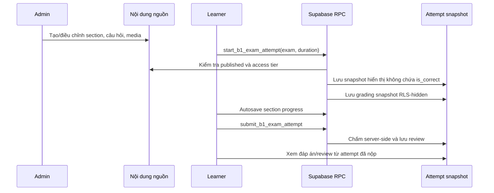
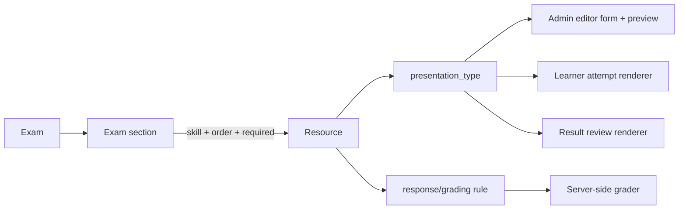

# B1 Exam Content & Admin Builder Implementation Plan

> **For agentic workers:** REQUIRED: Use `executing-plans` to implement this plan. Steps use checkbox (`- [ ]`) syntax for tracking.

**Goal:** Chuẩn hóa toàn bộ nội dung đề thi thành các section có dữ liệu, cách chấm và mẫu UI/UX độc lập; từ đó xây dựng trang quản trị trực quan để admin tạo, sửa, kiểm tra và xuất bản mọi phần của đề B1.

**Architecture:** Giữ `exams` là bộ điều phối và giữ snapshot attempt hiện tại để bảo toàn đề người học đã mở. Thay vì suy luận giao diện từ `skill`, `activity_type`, hoặc `source_key`, mỗi resource sẽ khai báo một `presentation_type` trong registry có kiểm soát. Registry quyết định form admin, renderer làm bài, renderer xem đáp án và chiến lược chấm.

**Tech Stack:** React 19, TypeScript, TanStack Query, Supabase/PostgreSQL/RLS/RPC, Tiptap, Tailwind CSS v4, Vitest, component UI Neobrutalist hiện có.

---

## 0. Audit triển khai — 2026-07-28

### Kết luận ngắn

Nền tảng dữ liệu, registry, snapshot an toàn, publish gate và builder trực quan đã có. B1 hiện vận hành được bằng presentation metadata cho phần lớn nội dung đang có. `matching`, `ordering` và `short_answer_list` đã có đủ editor/attempt/result; hai dạng cấu hình-only có snapshot riêng tư và publish gate. Writing/Speaking đã tách workspace làm bài và review/bài mẫu thành renderer riêng. Tuy nhiên phase **chưa hoàn tất**: vẫn còn các nhánh legacy trong hai page lớn; editor passage/image/media chưa đạt toàn bộ UX đã thiết kế; và chưa có lượt audit remote end-to-end cuối cùng.

| Hạng mục | Trạng thái | Bằng chứng hiện tại | Việc còn lại cần thiết |
|---|---|---|---|
| Registry, schema frontend | Hoàn thành | `presentationRegistry.ts`, Zod schema, test registry | Giữ registry là nơi duy nhất thêm presentation mới. |
| Migration/snapshot B1 | Hoàn thành cục bộ; cần xác minh remote cuối | `20260728002300_add_exam_presentation_registry.sql`, migration-contract test, verifier learner attempt | Chạy lại dry-run, kiểm tra migration remote và security advisors trước release. |
| Publish gate | Hoàn thành | readiness client, guarded RPC `set_b1_exam_published_guarded`, test service | Audit remote cuối và thêm test lỗi policy/RLS nếu schema đổi. |
| Admin builder | Hoàn thành phần lõi | picker, editor, preview, create/reorder/detach/add/delete question, tests | Clone/reuse section an toàn; editor media/image/passage phong phú hơn. |
| Attempt renderer | Một phần | resolver metadata, renderer inline/choice/transformation/matching/ordering/short answer/long form, Enter regression, fallback cấu hình lỗi | Tiếp tục giảm các nhánh legacy. |
| Result renderer | Một phần | inline, choice, transformation, matching, ordering, short answer, long form; sai nền đỏ; bài mẫu theo từng Writing/Speaking prompt; fallback cấu hình lỗi | Loại bỏ hết source-key inference ngoài fallback legacy. |
| Media/TTS | Hoàn thành workflow B1 cơ bản + thay audio có xác nhận | `AdminExamMediaPage`, upload audio/sign, TTS, usage impact, alt text và preset crop Signs, warning/`ConfirmModal` khi thay audio đã publish, media service/test | Media asset library/version độc lập và xóa storage theo usage chưa hoàn chỉnh. |
| 17 section B1 | Backfill có trong migration; regression full xanh | mapping `CASE`, `pnpm test` 120 files/503 tests, migration remote khớp local đến `20260728103907` | Cần smoke test browser có đăng nhập để đếm/mapping đủ 17 section trên remote. |

### Các rủi ro không được che giấu

- `ExamAttemptPage.tsx` và `ExamResultPage.tsx` vẫn là page lớn; chỉ một phần renderer được extract. Đây là rủi ro chính khi thêm presentation mới.
- `source_key` vẫn được dùng làm fallback cho attempt legacy và liên kết progress/review. Không được dùng nó để chọn UI mới; các nhánh còn lại phải tiếp tục chuyển sang `presentation_type`.
- Long-form đã là renderer riêng; các nhánh legacy còn lại không được dùng làm contract cho presentation mới.
- Builder hiện thêm/xóa resource source trực tiếp theo policy hiện có; chưa có RPC clone nguyên tử để đảm bảo workflow tái sử dụng section không tạo resource mồ côi khi lỗi giữa chừng.

---

## 1. Mục đích và phạm vi

Tài liệu này là bản chụp hiện trạng và kế hoạch kiến trúc trước khi xây dựng admin exam builder mới. Nó bao phủ ba màn hình dành cho học viên:

1. `/app/exams` — danh sách đề và lịch sử.
2. `/app/exams/attempt/:attemptId` — không gian làm bài.
3. `/app/exams/attempt/:attemptId/result` — xem kết quả, đáp án và bài Writing.

Mục tiêu tiếp theo không phải là viết một form chung thật lớn. Mục tiêu là để admin chỉ cần chọn “cách trình bày” bằng nhãn và preview dễ hiểu, ví dụ “Bài đọc + trắc nghiệm”, “Điền từ trong đoạn”, “Viết lại câu có từ khóa”, “Bài viết dài”, rồi hệ thống tự hiện đúng trường cần nhập và đúng trải nghiệm của học viên.

### 1.1. Mục tiêu

- Hỗ trợ trọn vẹn Listening, Speaking, Reading, Writing và Use of English trong cùng một đề.
- Hỗ trợ các dạng nội dung đã có trong B1 DeFull và mở rộng được mà không cần thêm điều kiện theo tên section.
- Tách lựa chọn UI/UX khỏi kỹ năng thi và khỏi cơ chế chấm điểm.
- Cho phép admin tạo nội dung bằng form trực quan, media picker và preview; không yêu cầu nhập JSON, HTML hay SQL thô.
- Giữ an toàn dữ liệu: đáp án không lộ trước khi nộp, attempt đang làm giữ snapshot riêng, và chỉ admin được chỉnh nội dung nguồn.
- Chấm tự động các câu objective; hỗ trợ review có lời giải/dịch; lưu nháp và so sánh phiên bản cho bài dài.

### 1.2. Không nằm trong phase builder đầu tiên

- Chấm Speaking bằng AI/audio recording.
- Chấm Writing tự động bằng AI hoặc CEFR rubric.
- Trình soạn PDF/drag-and-drop giống Word cho mọi layout tự do.
- Xóa hoặc sửa ngược snapshot của attempt đã bắt đầu.

Các khả năng này được chuẩn bị bằng dữ liệu/rubric và media model, nhưng không nên làm chúng điều kiện để hoàn thành phase admin đầu tiên.

---

## 2. Hiện trạng kiến trúc và dữ liệu

### 2.1. Cấu trúc hiện có

| Tầng | Trách nhiệm hiện tại | Ghi chú |
|---|---|---|
| `exams` | Catalog đề, thời lượng mặc định, trạng thái xuất bản, access tier | Một đề điều phối nhiều section. |
| `exam_sections` | Thứ tự, kỹ năng, liên kết resource, bắt buộc/không bắt buộc | Là liên kết đề ↔ nội dung tái sử dụng. |
| `practice_activities` | Resource objective: instruction, passage/content, audio, activity type | Chứa nhiều `practice_questions`. |
| `practice_questions` | Prompt, options, đáp án, ảnh, dịch/lời giải | Dùng cho câu objective. |
| `practice_prompts` | Prompt Writing/Speaking, instruction, nội dung, ảnh/audio | Không có câu objective. |
| `practice_prompt_samples` | Bài mẫu Writing để so sánh sau nộp | Result page hiện chỉ truy vấn Writing. |
| `exam_attempts` | Snapshot học viên, timer, trạng thái, elapsed/overtime | Đáp án được tách khỏi snapshot hiển thị. |
| `exam_section_attempts` | Progress, trạng thái section, điểm, draft version | Autosave làm việc qua RPC. |
| `practice_draft_versions` | Tối đa năm phiên bản nháp mỗi user/prompt | Hiện dùng cho Writing/Speaking. |

### 2.2. Luồng an toàn hiện có



Đây là nền tảng đúng cần giữ. Một thay đổi nội dung sau khi admin xuất bản không được làm thay đổi attempt học viên đang làm hoặc kết quả đã nộp.

---

## 3. Inventory đầy đủ hiện có trên ba trang học viên

## 3.1. Trang đề thi — `/app/exams`

### Đã triển khai

- Catalog đề B1 đã xuất bản, tìm kiếm theo tên/mô tả và lọc Free/Pro.
- Cấu hình một đồng hồ chung cho toàn bộ đề: preset 90/120/150 phút hoặc nhập 1–480 phút.
- Gợi ý phân bổ thời gian theo Grammar & Reading, Listening, Writing & Speaking.
- Bắt đầu đề qua `start_b1_exam_attempt`; thời lượng đã chọn được lưu thành `target_duration_seconds`.
- Lịch sử chia thành “Bài thi đang làm dở” và “Bài thi đã hoàn thành”.
- Continue attempt, đóng attempt đang dở (trạng thái `abandoned`), xem kết quả attempt đã nộp, và làm lại từ Result bằng attempt mới.
- Toàn bộ thao tác đóng bài dùng `ConfirmModal`, không dùng browser dialog.

### UI/UX cần giữ trong builder

- Thời lượng là cấu hình của attempt, không phải cấu hình cứng của từng section.
- Khối catalog hiển thị số kỹ năng, access tier, thời lượng mặc định và readiness trước khi bắt đầu.
- Một đề chưa có đủ section bắt buộc/published/media required phải bị chặn xuất bản hoặc hiển thị checklist rõ ràng cho admin.

### Giới hạn hiện có

- Catalog chỉ mô tả chung “4 kỹ năng”; chưa hiển thị cấu trúc section động từ builder.
- Không có trạng thái kiểm tra tính hoàn chỉnh của nội dung trước khi publish.
- Attempt `abandoned` bị ẩn khỏi hai nhóm hiện có; admin cần vẫn thấy nó trong thống kê, nhưng learner không cần resume nó.

## 3.2. Trang làm bài — `/app/exams/attempt/:attemptId`

### Khung dùng chung đã triển khai

- Header sticky: quay về hub, tên đề, section hiện tại, autosave indicator, số câu đã làm, đồng hồ đếm ngược/quá giờ.
- Quá giờ chỉ cảnh báo; người học vẫn làm và nộp được.
- Sidebar section navigator với trạng thái hoàn thành; question quick-jump cho section objective.
- Navigation trước/sau section, scroll lên đầu mượt sau khi chuyển section.
- Autosave objective answer và draft prompt; progress được hydrate khi mở lại attempt.
- Nút nộp bài có confirm modal và chuyển sang Result sau khi server submit thành công.

### Dạng section B1 hiện đang hiển thị

| # | Source section | Kỹ năng | Resource | Presentation thực tế hiện tại | Input/chấm |
|---:|---|---|---|---|---|
| 1 | Grammar & Use of English | Grammar | activity, 20 câu | Danh sách trắc nghiệm A–D | Single-choice, chấm option key |
| 2 | Signs | Signs/Reading | activity, 10 câu | Ảnh sign + trắc nghiệm | Single-choice; ảnh thuộc question |
| 3 | Text 2: Coasteering | Reading | activity, 5 câu | Đoạn đọc + trắc nghiệm | Single-choice |
| 4 | Text 3: Karina Moore | Reading | activity, 5 câu | Đoạn đọc + trắc nghiệm | Single-choice |
| 5 | Cloze Text 15: William the Hero | Cloze | activity, 10 câu | Đoạn văn có blank inline + lựa chọn | Option key được map thành text trong passage/review |
| 6 | Sentence Transformation | Transformation | activity, 10 câu | Câu gốc + keyword + input rewrite theo dòng | Free text; punctuation-only được bỏ qua khi chấm |
| 7 | Writing Topic 7 | Writing | prompt | Đề + textarea, autosave, tạo phiên bản | Nháp dài, tối đa 5 version |
| 8 | Listening Text 1: Being a Kid | Listening | activity, 10 câu | Nội dung có blank inline + input | Free text; Enter chuyển focus sang blank kế tiếp |
| 9 | Listening Text 31 | Listening | activity, 5 câu | Audio (nếu có) + trắc nghiệm | Single-choice |
| 10 | Listening Text 34 | Listening | activity, 5 câu | Audio (nếu có) + trắc nghiệm | Single-choice |
| 11 | Listening Text 52 | Listening | activity, 5 câu | Audio (nếu có) + True/False | Boolean choice |
| 12 | Listening Text 56 | Listening | activity, 5 câu | Audio (nếu có) + True/False | Boolean choice |
| 13 | Speaking test instructions | Speaking | prompt | Đề/instruction + draft workspace | Nháp dài, chưa ghi âm/chấm nói |
| 14 | Speaking example | Speaking | prompt | Đề/instruction + draft workspace | Nháp dài |
| 15 | Speaking Topic 33 | Speaking | prompt | Đề + chuẩn bị script | Nháp dài |
| 16 | Speaking Topic 34 | Speaking | prompt | Đề + chuẩn bị script | Nháp dài |
| 17 | Speaking Topic 35 | Speaking | prompt | Đề + chuẩn bị script | Nháp dài |

### Hành vi chi tiết đã xử lý

- Multiple choice/true-false: render option text đầy đủ, không cắt đáp án dài; đáp án mỗi câu độc lập.
- Inline gaps: placeholder được nhận dạng trong content/passage; Enter lưu và focus blank kế tiếp. Trùng số blank chỉ có một input nguồn để tránh một câu điền thay đổi câu khác.
- Sentence transformation: input nằm đúng bên dưới câu hỏi; layout hỗ trợ prefix/suffix, input tự mở rộng; Enter chuyển câu tiếp theo; so sánh theo ký tự nhưng UI nhóm theo word để không làm chữ bị tách rời.
- Prompt Writing/Speaking: autosave, explicit immutable checkpoint, danh sách phiên bản để chọn so sánh; TTS/audio phát khi resource có audio URL.

### Điểm yếu kiến trúc hiện tại

1. `activity_type` hiện chỉ là `multiple_choice | true_false | fill_blank | short_text`. Nó đang bị dùng lẫn cho **kiểu input**, **kiểu bố cục**, và đôi khi **cách chấm**.
2. Renderer phát hiện inline gap bằng regex `(…|___)` trong `passage/content`; sentence transformation parse từ text theo xuống dòng/keyword. Đây là heuristic phù hợp cho import PDF, không phù hợp làm contract lâu dài của admin.
3. `skill` được dùng để chọn badge/icon; `source_key` lại được dùng để suy ra title và Result treatment. Một section mới không theo pattern tên hiện hữu có thể hiển thị sai.
4. `content`, `passage`, `instructions` là string đơn. Chúng không biểu diễn được layout gồm nhiều block, nhiều audio/ảnh, hoặc một đoạn văn có metadata về từng blank.
5. Section prompt và activity hiện có nhánh dữ liệu riêng, nhưng editor admin mới phải xử lý cả hai và phải tránh buộc admin hiểu schema.

## 3.3. Trang xem đáp án — `/app/exams/attempt/:attemptId/result`

### Đã triển khai

- Chỉ mở khi `attempt.status = submitted`; attempt chưa nộp quay lại màn làm bài.
- Summary: điểm objective, độ chính xác, đúng/sai/bỏ trống, thời gian và overtime.
- Filter tất cả/đúng/sai, section selector, question jumper có màu đúng/sai/trống.
- Result được nhóm theo section, không chỉ là một danh sách câu phẳng.
- Multiple choice/true-false: đáp án người học chọn sai có nền đỏ; đáp án đúng nền vàng; option hiển thị nội dung thay vì chỉ A/B/C/D.
- Cloze/inline gap: render lại passage, hiển thị text đáp án đúng và text người học đã chọn/điền, không chỉ key A/B/C/D.
- Sentence transformation: so sánh token/ký tự để chỉ ra sai nhỏ; punctuation-only không bị tính sai; underline không đè đuôi ký tự như `g`, `y`.
- Translation và detailed explanation hiển thị nếu câu có dữ liệu review.
- Writing review: hiện phần bài người học đã nộp; nạp bài mẫu; so sánh nội dung với bài mẫu, highlight phần khác nhau; việc so sánh bỏ qua khác biệt chỉ do dấu câu, khoảng trắng hoặc xuống dòng.
- “Làm lại bài thi” tạo attempt mới với cùng duration thay vì cố dùng lại attempt đã submit.

### Hạn chế cần giải quyết trong builder

- Lời giải/dịch được lưu ở `practice_questions`, nhưng form admin hiện chưa có một editor chuyên dụng để nhập/review đầy đủ cho mọi presentation.
- Result có mô hình review chi tiết cho objective, Writing và Speaking sample; transcript/answer rationale theo part cho Listening/Speaking vẫn chưa có.
- Presentation Result hiện suy luận bằng `source_key`, không phải renderer metadata.
- Không có rubric, feedback block, transcript/answer rationale theo part cho Listening/Speaking.

---

## 4. Phân tích: ba trục phải tách rời

Không thể chọn UI chỉ bằng “Listening/Reading/Writing/Speaking”. Một kỹ năng có nhiều cách hiển thị và một presentation có thể dùng ở nhiều kỹ năng.

| Trục | Câu hỏi cần trả lời | Ví dụ |
|---|---|---|
| **Skill** | Đây là năng lực nào? | listening, reading, grammar, writing, speaking |
| **Response / grading model** | Học viên trả lời gì và hệ thống chấm thế nào? | chọn 1 option, true/false, text chính xác, transformation normalized, draft version |
| **Presentation type** | Học viên nhìn/nhập như thế nào? | danh sách A–D, passage + blank inline, sign image card, sentence rewrite, long-form editor |

Ví dụ: “Cloze Text” là Reading/Cloze về skill; có response kiểu `single_choice`; nhưng presentation phải là `inline_choice_passage`, không phải một danh sách 10 câu trắc nghiệm. “Listening Text 1” có response kiểu `exact_text`, nhưng presentation là `inline_text_gap_passage` và cần audio. “Sentence Transformation” là `normalized_text` nhưng presentation là `sentence_transformation`.

### Quyết định thiết kế

**Không tạo component khác nhau chỉ theo skill.** Tạo một registry presentation có contract dữ liệu riêng; section giữ skill như metadata/reporting/accessibility, còn renderer được chọn từ `presentation_type`.



---

## 5. Presentation registry đề xuất

`presentation_type` là enum versioned, không phải string tự do. Mỗi type có label tiếng Việt, mô tả, icon, preview thumbnail, field schema, validator, learner renderer, result renderer và grading mode được phép.

| Presentation type | Dùng cho | Cách học viên làm | Grading mode hợp lệ | B1 hiện tại |
|---|---|---|---|---|
| `choice_list` | Grammar, Listening, Reading | Một câu + lựa chọn A–D | `single_choice` | Grammar, Reading 2/3, Listening 31/34 |
| `boolean_list` | Listening/Reading đúng-sai | Mỗi câu True/False | `single_choice` | Listening 52/56 |
| `image_choice_list` | Signs, picture question | Ảnh + câu + lựa chọn | `single_choice` | Signs 1–10 |
| `passage_choice_inline` | Cloze | Đoạn văn có marker, popup/row lựa chọn mỗi gap | `single_choice` | William the Hero |
| `passage_text_inline` | Listening/Reading điền từ | Đoạn văn có marker, input inline | `exact_text`, `normalized_text` | Being a Kid |
| `passage_questions` | Reading comprehension | Passage cố định ở trên/side-by-side + list choice | `single_choice` | Coasteering, Karina Moore |
| `sentence_transformation` | Use of English/Writing | Câu gốc, keyword, câu khung + input expansion | `normalized_text` | Transformation 1–10 |
| `short_answer_list` | Câu trả lời ngắn độc lập | Danh sách input ngắn | `exact_text`, `normalized_text` | Chưa dùng nhưng cần |
| `long_form_prompt` | Writing/Speaking preparation | Prompt + word count + version editor | `manual`, `sample_compare` | Writing 7, Speaking topics |
| `speaking_script_prompt` | Speaking phase sau này | Prompt + preparation notes/script; future recording | `manual`, `sample_compare`, future `rubric` | Speaking 33–35 |
| `matching` | Matching heading/person/place | Kéo-thả hoặc select từng cặp | `matching` | Future |
| `ordering` | Sắp xếp câu/đoạn | Drag/drop hoặc up/down accessible control | `ordered_list` | Future |

### Quy tắc registry

- Không dùng `source_key` để quyết định UI hoặc title hiển thị.
- Không cho admin chọn tổ hợp không hợp lệ, ví dụ `image_choice_list` với `normalized_text`.
- Nếu chọn presentation cần media, UI hiển thị ô media required/optional đúng context.
- Nếu chọn presentation chứa passage inline, UI sử dụng visual blank editor; không buộc admin tự gõ regex/placeholder.
- Nếu type chưa có learner/result renderer, admin thấy “chưa sẵn sàng xuất bản”, không thể publish section đó.

---

## 6. Contract dữ liệu đề xuất

## 6.1. Resource chung

Mở rộng activity/prompt về một contract logical chung (có thể migration dần, không cần xóa bảng cũ ngay):

```ts
type PresentationType =
  | 'choice_list'
  | 'boolean_list'
  | 'image_choice_list'
  | 'passage_choice_inline'
  | 'passage_text_inline'
  | 'passage_questions'
  | 'sentence_transformation'
  | 'short_answer_list'
  | 'long_form_prompt'
  | 'speaking_script_prompt'
  | 'matching'
  | 'ordering'

type GradingMode =
  | 'single_choice'
  | 'exact_text'
  | 'normalized_text'
  | 'manual'
  | 'sample_compare'
  | 'matching'
  | 'ordered_list'
```

Trường logic tối thiểu cho resource:

| Field | Ý nghĩa |
|---|---|
| `presentation_type` | Renderer được dùng ở cả admin/learner/result. |
| `grading_mode` | Hợp đồng server-side grading. |
| `content_blocks` | Danh sách block typed: rich text, image, audio, passage, callout, blank group. |
| `config` | Cấu hình đã validate theo presentation schema; không cho learner nhập raw JSON. |
| `review_config` | Hướng dẫn, dịch, rubric, sample policy, feedback blocks. |
| `version` | Phiên bản resource nguồn; snapshot lưu version và normalized content. |

`content_blocks` nên dùng JSONB có schema; admin chỉnh qua editor trực quan. Ví dụ passage inline:

```ts
{
  presentation_type: 'passage_text_inline',
  grading_mode: 'normalized_text',
  content_blocks: [
    { type: 'audio', media_id: '...' },
    {
      type: 'inline_gap_passage',
      segments: [
        { type: 'text', value: 'I always have to ' },
        { type: 'gap', gap_id: 'gap-1', label: '1', width: 'md' },
        { type: 'text', value: ' my plate.' }
      ]
    }
  ],
  config: { enter_behavior: 'next_gap', case_sensitive: false }
}
```

Việc có `gap_id` ổn định thay thế cho suy luận “số 9 xuất hiện hai lần”; cùng một gap chỉ tồn tại một answer value. Renderer có thể hiển thị nó ở nhiều nơi nhưng không được tạo state độc lập.

## 6.2. Question và đáp án

Không lộ đáp án trong learner snapshot. Server-side grading snapshot tiếp tục chứa answer key.

| Grading mode | Payload học viên | Answer key server | Review cần lưu |
|---|---|---|---|
| `single_choice` | `question_id -> option_id` | đúng một/một tập option id | selected option text + correct option text |
| `exact_text` | `gap_id/question_id -> text` | alternatives + case/space rules | input + accepted answer |
| `normalized_text` | text | normalization profile + alternatives | token/word diff, normalized match |
| `manual` | draft/version id | không auto-score | draft, rubric state |
| `sample_compare` | draft/version id | sample references, not “answer key” | highlighted semantic-normalized comparison |
| `matching` | pair mapping | mapping | pair result |
| `ordered_list` | array item ids | expected order | ordered diff |

### Normalization profile

Không hard-code riêng cho Sentence Transformation. Mỗi text question có `normalization_profile` chọn bằng checkbox dễ hiểu trong admin:

- Bỏ qua hoa/thường.
- Bỏ qua khoảng trắng thừa và xuống dòng.
- Bỏ qua dấu câu.
- Bắt buộc dấu câu.
- Cho phép nhiều đáp án tương đương.

Sentence Transformation B1 hiện dùng “bỏ qua dấu câu”; những loại khác có thể bật “bắt buộc dấu câu”. Điều này đáp ứng yêu cầu “thiếu dấu gì thì sai/chỉ loại được cấu hình mới bỏ qua”, thay vì áp dụng một luật chung cho mọi câu.

---

## 7. Thiết kế UI/UX trang admin

## 7.1. Information architecture

```
Quản trị đề thi
├── Danh sách đề
│   ├── trạng thái Draft / Ready for review / Published / Archived
│   └── số section, media thiếu, validation issue
├── Chi tiết đề
│   ├── Thông tin chung + thời lượng mặc định + access tier
│   ├── Cấu trúc đề (section timeline, reorder)
│   ├── Kiểm tra trước xuất bản
│   └── Preview đề như học viên
├── Thư viện nội dung
│   ├── Activities objective
│   ├── Writing/Speaking prompts
│   ├── Bài mẫu
│   └── Media (ảnh, audio upload, audio TTS)
└── Builder section
    ├── Chọn kỹ năng
    ├── Chọn cách trình bày UI/UX
    ├── Form nội dung chuyên biệt
    ├── Đáp án + dịch + lời giải/rubric
    └── Live preview học viên + preview kết quả
```

## 7.2. Wizard tạo section — không dùng form kỹ thuật

### Bước 1: “Nội dung này kiểm tra kỹ năng nào?”

Chọn card có icon: Grammar & Use of English, Reading, Listening, Writing, Speaking, Signs. Đây là metadata/reporting; bước này không quyết định layout.

### Bước 2: “Học viên sẽ làm theo cách nào?”

Chọn presentation card có preview nhỏ, mô tả và ví dụ:

- “Chọn một đáp án” — câu hỏi và A–D.
- “Đọc đoạn văn rồi chọn đáp án”.
- “Điền từ ngay trong đoạn văn”.
- “Viết lại câu với từ gợi ý”.
- “Viết bài/chuẩn bị bài nói”.
- “Xem ảnh/sign rồi chọn đáp án”.

Card không tương thích với skill vẫn có thể xuất hiện nếu hợp lý, nhưng có mô tả. System chặn lựa chọn không có renderer.

### Bước 3: Editor chuyên biệt

| Presentation | Admin nhìn thấy | Không được yêu cầu admin làm |
|---|---|---|
| Choice/boolean | Câu hỏi, option cards, radio chọn đáp án đúng, dịch/lời giải | Gõ JSON options |
| Image choice | Media picker/upload, crop/alt text, question/options | Dán URL file thủ công |
| Passage questions | Rich-text passage editor, danh sách question cards bên dưới | Viết HTML raw |
| Inline gap passage | Rich-text passage editor; chọn text → “Tạo ô trống”; panel từng gap | Tự chèn `(1) ____` hoặc regex |
| Transformation | Câu gốc, keyword, prefix, ô trống, suffix, acceptable answers, normalization toggles | Format nhiều dòng đặc biệt để parser đoán |
| Long-form prompt | Prompt rich text, instruction, word-count guide, TTS/media, bài mẫu, rubric optional | Gõ raw markdown/HTML |
| Speaking script | Prompt, preparation phases, TTS/audio, sample script, future recording config | Gõ cấu hình audio JSON |

### Bước 4: Review & xuất bản

- Hai tab preview: “Học viên làm bài” và “Học viên xem đáp án”.
- Checklist theo presentation: thiếu option đúng, blank chưa có đáp án, media bắt buộc, alt text ảnh, thiếu explanation/translation, không có sample khi `sample_compare` yêu cầu.
- Chỉ cho publish resource khi validation pass; đề chỉ publish khi tất cả section required pass và learner có quyền truy cập media cần thiết.

## 7.3. Media và TTS

Tách media thành thư viện có metadata thay vì chỉ lưu URL:

| Khả năng | Cần có |
|---|---|
| Upload audio | tên hiển thị, ngôn ngữ, transcript optional, duration, trạng thái upload, preview player |
| Upload ảnh | alt text, copyright/source note optional, crop/preview, usage list |
| TTS | chọn giọng/ngôn ngữ/tốc độ, preview, generate, lưu media version, replace có confirm |
| Gắn media | media picker cho section hoặc question tùy presentation |
| Kiểm tra | cảnh báo audio required nhưng chưa có; TTS không thay transcript nếu section cần transcript |

Audio là **content block** nên Listening có thể yêu cầu audio, Writing/Speaking có thể có TTS prompt, và Reading vẫn có audio optional mà không thay đổi renderer.

---

## 8. Result renderer theo presentation, không theo source key

| Presentation | Result UX bắt buộc |
|---|---|
| Choice/boolean/image choice | Đáp án học viên sai nền đỏ; đáp án đúng nền vàng; text option đầy đủ; translation/explanation bên dưới. |
| Passage choice inline | Render lại đoạn văn, thay gap bằng option text của user và đáp án đúng; không hiển thị chỉ A/B/C/D. |
| Passage text inline | Render lại passage, input đúng/sai inline, accepted answer; explanation theo gap hoặc section. |
| Passage questions | Passage + question review cards; question jumper link đúng question. |
| Transformation | Câu gốc/keyword/câu trả lời; word-grouped diff; punctuation feedback theo normalization profile. |
| Long-form prompt | Nội dung bài nộp, version list, sample picker, comparison bỏ qua formatting-only diff, rubric/feedback if present. |
| Speaking script | Script đã nộp, sample script (nếu có), compare; future recording/replay/rubric. |

Mọi result renderer nhận cùng structured review payload; không tự parse title hay `source_key` để quyết định hành vi.

---

## 9. Migration strategy — tránh phá vỡ B1 đang chạy

### Phase A — Registry và compatibility layer

- Thêm `presentation_type`, `grading_mode`, `content_schema_version`, `content_blocks`, `config`, `review_config` nullable vào resource phù hợp.
- Backfill 17 section B1 theo bảng ở mục 3.2.
- Learner renderer đọc metadata mới trước; fallback về legacy renderer cho resource chưa migration.
- Snapshot mới chứa metadata đã chuẩn hóa; snapshot cũ tiếp tục dùng schema hiện có.

### Phase B — Admin builder mới

- Xây library registry TypeScript dùng chung ở frontend/admin/validator.
- Tạo form/presentation editors theo từng card; mỗi editor có preview attempt/result.
- Tạo server validation mirror cho data khi save/publish.

### Phase C — Grading/review contract

- Chuẩn hóa review payload theo `presentation_type`, không đổi logic chấm existing trước khi có test parity.
- Di chuyển punctuation rules sang `normalization_profile` per question.
- Thêm rubric/sample model dùng chung Writing/Speaking.

### Phase D — Media governance và analytics

- Media library, TTS job/status, usage references.
- Analytics theo `exam_id`, `section_id`, `presentation_type`, `question_id`; không chỉ theo skill.

---

## 10. File structure mục tiêu

| File/nhóm file | Trách nhiệm |
|---|---|
| `src/features/exam-content/presentationRegistry.ts` | Enum, label, compatible grading modes, metadata UI, schema dispatch. |
| `src/features/exam-content/schemas/*.ts` | Zod schemas typed cho từng presentation config/content block. |
| `src/components/exam/presentations/*Attempt.tsx` | Learner renderer tách nhỏ theo presentation. |
| `src/components/exam/presentations/*Result.tsx` | Result/review renderer tương ứng. |
| `src/components/admin/exam-presentations/*Editor.tsx` | Form admin trực quan + live preview. |
| `src/pages/admin/AdminB1ExamBuilderPage.tsx` | Orchestrate exam structure, wizard và publish checklist; không nhồi toàn bộ editor vào một file. |
| `src/services/supabase/adminExamContent.service.ts` | CRUD typed, preview/publish validation; không gọi Supabase trực tiếp trong component. |
| `src/services/supabase/examPractice.service.ts` | Start/save/submit attempt typed cho content schema mới. |
| `src/types/exam.types.ts` hoặc `src/types/examContent.types.ts` | Types domain tách legacy vs schema mới. |
| `supabase/migrations/*_add_exam_presentation_registry.sql` | Schema, constraints, RLS, snapshot/RPC adaptation. |
| `supabase/migrations/*_backfill_b1_presentation_types.sql` | Idempotent mapping 17 section B1. |

Không mở rộng `AdminExamBuilderPage.tsx` legacy (passage sets TOEIC/IELTS) thành một mega-file. Builder B1/content model là một domain khác và cần một page + components chuyên trách, nhưng có thể dùng chung catalog/exam metadata UI.

---

## 11. Implementation tasks

## Chunk 1: Foundation và registry

### Task 1: Chốt domain model và validator

**Files:**

- Create: `src/features/exam-content/presentationRegistry.ts`
- Create: `src/features/exam-content/schemas/presentationSchemas.ts`
- Create: `src/features/exam-content/presentationRegistry.test.ts`
- Modify: `src/types/exam.types.ts`

- [x] Viết test fail cho danh sách presentation, compatibility `presentation_type ↔ grading_mode`, và schema invalid.
- [x] Chạy test để xác nhận fail vì registry chưa tồn tại.
- [x] Implement enum, Vietnamese labels, metadata preview và Zod schema tối thiểu.
- [x] Chạy test registry; sau đó `pnpm tsc -b`.
- [x] Commit: `feat: add exam content presentation registry`.

### Task 2: Schema migration và snapshot compatibility

**Files:**

- Create: migration mới qua `npx supabase migration new add_exam_presentation_registry`
- Modify: RPC migrations cho `start_b1_exam_attempt`, `save_b1_section_attempt_progress`, `submit_b1_exam_attempt`
- Test: migration SQL verification/smoke test theo project convention

- [x] Viết test/smoke case xác nhận learner snapshot không chứa answer key nhưng chứa presentation metadata.
- [x] Thêm columns/constraints và guarded RPC adaptation (`SECURITY DEFINER`, fixed `search_path`, grants đúng role).
- [x] Dry-run migration qua `scripts/check-supabase-migration-dry-run.mjs` trong lượt triển khai migration ban đầu.
- [x] Remote migration list khớp local đến `20260728103907`; `db push --dry-run` báo up-to-date, `db lint --fail-on error` và security advisors error-level đều qua. Snapshot runtime vẫn cần browser đăng nhập/RLS test.
- [x] Commit: `feat: persist exam presentation metadata`.

## Chunk 2: Renderer migration có parity

### Task 3: Tách learner renderer theo presentation

**Trạng thái audit:** Một phần. Đã có resolver metadata, `InlineChoicePassageAttempt`, `ChoiceListAttempt`, `ShortAnswerListAttempt`, `SentenceTransformationAttempt`, `MatchingAttempt`, `OrderingAttempt`, `LongFormPromptWorkspace` và regression Enter cho input theo danh sách/viết lại câu. Page chỉ giữ orchestration của draft/autosave.

**Bằng chứng đã hoàn thành:**

- [x] `InlineChoicePassageAttempt`, `ChoiceListAttempt`, `ShortAnswerListAttempt`, `SentenceTransformationAttempt` có test component; các input list/transformation hỗ trợ Enter sang câu kế tiếp.
- [x] `ExamAttemptPage` resolve `presentation_type` trước, còn renderer cũ chỉ là compatibility path.
- [x] `LongFormPromptWorkspace` tách UI Writing/Speaking: soạn draft, đếm từ, checkpoint phiên bản và so sánh hai phiên bản; autosave vẫn do orchestration hiện hữu gọi service.
- [x] `MatchingAttempt`/`OrderingAttempt` có renderer typed; publish block chỉ còn áp dụng khi config không hợp lệ.

**Files:**

- Create: `src/components/exam/presentations/*`
- Modify: `src/pages/exams/ExamAttemptPage.tsx`
- Test: `src/components/exam/presentations/*.test.tsx`, `src/pages/exams/ExamAttemptPage.test.tsx`

- [x] Có regression component cho `choice_list`, `sentence_transformation`, `long_form_prompt`; inline presentation có regression riêng.
- [x] Di chuyển các renderer typed hiện có, giữ Enter/focus/autosave behavior hiện tại.
- [x] `getPresentationConfigurationIssue` bao phủ empty objective, inline passage, Writing/Speaking; Matching/Ordering giữ validator typed riêng. Attempt/result đều render `role="alert"` thay vì vùng trống.
- [x] Chạy test component liên quan và `pnpm tsc -b`.
- [x] Commit theo presentation nhỏ: `f6a92ae refactor: extract long form exam workspace`.

### Task 4: Tách result renderer theo presentation

**Trạng thái audit:** Một phần. Đã có `InlineGapPassageResult`, `ChoiceQuestionResult`, `SentenceTransformationResult`, `MatchingResult`, `OrderingResult`, `ShortAnswerListResult`, `LongFormPromptResult`, review sai nền đỏ, option text và so sánh bài mẫu theo từng Writing/Speaking prompt; snapshot title/skill đã được ưu tiên. Fallback typed đầy đủ vẫn chưa tách.

**Bằng chứng đã hoàn thành:**

- [x] `ChoiceQuestionResult` hiển thị lựa chọn sai nền đỏ và đáp án đúng nền vàng, kèm toàn bộ option text.
- [x] `InlineGapPassageResult` map option key sang nội dung đáp án trong đoạn văn.
- [x] `SentenceTransformationResult` giữ so sánh ở mức token nhưng không tách rời bố cục câu viết lại.
- [x] `LongFormPromptResult` tách review Writing/Speaking; sample được tải độc lập theo từng prompt, bao gồm Speaking.
- [ ] Tạo fallback metadata-first cho mọi attempt legacy, rồi mới loại bỏ source-key inference còn lại.

**Files:**

- Create: `src/components/exam/presentations/*Result.tsx`
- Modify: `src/pages/exams/ExamResultPage.tsx`
- Test: `src/pages/exams/ExamResultPage.test.tsx`

- [x] Có regression cho wrong-selected red state, inline option text, punctuation-tolerant Writing/Speaking sample comparison.
- [ ] Chuyển logic source-key inference sang presentation metadata.
- [ ] Kiểm tra review của attempt legacy vẫn hiển thị được qua fallback mapping.
- [x] Chạy test component liên quan và `pnpm tsc -b`.
- [x] Commit theo presentation nhỏ: `ab01f0f refactor: extract long form result renderer`.

## Chunk 3: Admin experience

### Task 5: Exam structure workspace và presentation picker

**Files:**

- Create: `src/pages/admin/AdminB1ExamBuilderPage.tsx`
- Create: `src/components/admin/exam-presentations/PresentationPicker.tsx`
- Create: `src/services/supabase/adminExamContent.service.ts`
- Modify: `src/app/routes.tsx`, admin navigation
- Test: page/service tests

- [x] Viết test fail: admin chọn “Điền từ trong đoạn văn” thì chỉ thấy visual passage-gap editor, không thấy raw JSON input.
- [x] Implement section timeline/reorder, skill picker, presentation picker, draft/published status.
- [x] Chỉ dùng `Button`, `Select`, `ConfirmModal` và editor/media picker project; không dùng native select/window confirm.
- [x] Chạy test và `pnpm tsc -b`.
- [x] Commit: `feat: add B1 exam section builder`.

### Task 6: Các editor có giá trị cao trước

**Trạng thái audit:** Một phần. Choice/boolean, inline gap, transformation, long-form/speaking, sample, preview và review authoring đã có. `passage_questions` vẫn dùng editor choice chung; image choice chưa có picker/alt/crop trong builder; validation editor chưa đủ toàn bộ contract đã mô tả.

**Files:**

- Create: choice, passage, inline-gap, transformation, long-form editors
- Test: each editor validation and preview

- [ ] Implement theo thứ tự: `choice_list`/`boolean_list`, `passage_questions`, `passage_*_inline`, `sentence_transformation`, `long_form_prompt`/`speaking_script_prompt`.
- [ ] Mỗi editor preview attempt + result, validation inline, review authoring và save draft.
- [ ] Commit từng presentation hoặc nhóm nhỏ cùng behavior; không dồn thành một commit lớn.

## Chunk 4: Media, publish gate và B1 migration

### Task 7: Media/TTS quản trị

**Trạng thái audit:** Hoàn thành workflow B1 cơ bản. Upload audio, upload sign image, TTS, preview, publish readiness và trang quản trị riêng đã có. Thay audio của resource đã publish (URL/upload/TTS) luôn hiển thị impact warning và yêu cầu `ConfirmModal`; attempt cũ giữ snapshot nên không bị đổi. Danh sách resource hiển thị số section/tên đề sử dụng chung, Signs có alt text và preset crop lưu trong metadata; crop được áp dụng ở admin, attempt và result. Chưa hoàn thành media asset library/version độc lập và xóa storage theo usage.

**Files:**

- Create: media service/components/migrations tùy schema hiện hữu
- Modify: presentation editors, admin navigation
- Test: upload/link/TTS preview/required media validation

- [x] Media workflow trực quan có upload audio/image, TTS create/preview và usage warning theo section/đề.
- [x] Thay hoặc gỡ URL audio trên resource published yêu cầu confirm và hiển thị impact; storage-asset deletion vẫn chưa expose nên không thể xóa nhầm file đang dùng.
- [ ] Commit: `feat: manage exam media and TTS assets`.

### Task 8: Backfill B1 và release gate

**Files:**

- Create: backfill migration + fixture mapping 17 section
- Modify: publish validation + docs
- Test: snapshot, admin preview, attempt, result regression suite

- [x] Backfill mapping presentation cho 17 section ở mục 3.2 idempotently.
- [ ] Hoàn thiện test snapshot mới, attempt UI, result UI và existing submission review cho mọi presentation (đang có regression từng phần).
- [x] Verify remote migration khớp local đến `20260728103907`, `pnpm test` (120 files/503 tests) và `pnpm tsc -b`.
- [ ] Browser E2E đăng nhập thật cho đủ 17 section và remote RLS/advisors ở lượt release cuối.
- [x] Commit: `feat: migrate B1 content to presentation builder`.

---

## 12. Acceptance criteria cho phase admin tiếp theo

### Trạng thái audit acceptance

| Tiêu chí | Trạng thái |
|---|---|
| Tạo section không cần DB/JSON/HTML | Đạt cho workflow hiện tại. |
| Chọn presentation và chỉ thấy field liên quan | Đạt phần presentation đã hỗ trợ. |
| Attempt/result cùng `presentation_type`, không phụ thuộc `source_key` | Chưa đạt hoàn toàn; metadata-first + legacy fallback đang chuyển đổi. |
| 17 section không mất hành vi B1 đã sửa | Đạt một phần qua regression riêng; chưa có audit E2E toàn bộ 17. |
| Thêm matching/ordering chỉ cần registry + 3 components | Đạt; mỗi type có editor, attempt, result, validation, snapshot grading và publish gate. |
| Không lộ answer key trước submit | Đạt qua snapshot/grading contract test và guarded RPC. |
| Publish gate + preview learner/result | Đạt phần gate/preview hiện tại; cần remote audit cuối. |
| Attempt cũ bất biến khi sửa source | Đạt theo snapshot contract; cần kiểm thử integration remote cuối. |

- Admin có thể tạo một section không cần biết database/JSON/HTML.
- Admin chọn được presentation bằng card có preview và hệ thống chỉ hiện field liên quan.
- Học viên attempt và result render cùng một `presentation_type`; không phụ thuộc `source_key` naming convention.
- Tất cả 17 B1 section hiện tại có mapping cụ thể và không mất hành vi đã sửa: Enter-to-next, inline blanks không bị duplicate, sign image, wrong answer red, answer text, normalized transformation, Writing compare.
- Bài tập mới có thể thêm “matching” hoặc “ordering” bằng một registry entry + 3 components (admin/attempt/result), không phải sửa một chuỗi `if` ở ba page lớn.
- Answer key không bao giờ có trong learner snapshot/API trước submit.
- Publish gate chặn missing required content/media/review data và cho preview cả learner/result.
- Existing attempts không đổi nội dung/điểm khi admin sửa source content sau đó.

---

## 13. Quyết định cần xác nhận trước khi code phase mới

1. Speaking phase tiếp theo có cần lưu audio recording của người học, hay vẫn chỉ script/draft + TTS prompt?
2. Bài mẫu Writing/Speaking có thể có nhiều mẫu cho một prompt và admin có muốn đánh dấu một mẫu “recommended” không?
3. Với Listening, transcript có được learner thấy trước khi nộp không; sau nộp có luôn hiển thị transcript không?
4. Có cần tái sử dụng một activity/prompt giữa nhiều đề ngay ở phase đầu, hay ưu tiên clone để admin ít lo tác động dây chuyền?
5. Cần rubric manual cho giáo viên trong phase builder, hay chỉ chuẩn bị schema để làm sau?

Các câu hỏi này ảnh hưởng policy/UX nhưng không thay đổi quyết định nền tảng: tách `skill`, `grading_mode` và `presentation_type`.
