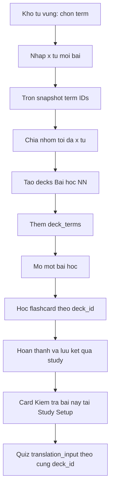

# Thiet Ke Tao Hang Loat Bai Hoc Tu Kho Tu Vung

**Ngay:** 2026-05-25
**Trang thai:** Thiet ke da duoc duyet

## Tong Quan

Bo sung kha nang chon mot danh sach tu da co trong Kho tu vung, tron ngau nhien va chia thanh nhieu bai hoc co toi da `x` tu moi bai. Trong MVP, mot bai hoc chinh la mot `deck` duoc tao tu dong, vi luong hoc flashcard va kiem tra nhap ban dich hien tai da deu ho tro nguon theo `deck`.

Sau khi hoan thanh flashcard cua mot bai hoc, nguoi hoc co the bam `Kiem tra bai nay` de lam ngay bai kiem tra chi voi tu vung thuoc deck vua hoc. Tinh nang tap trung vao viec tao nhanh nhieu bai va chuyen tiep tu hoc sang kiem tra; chua tao khai niem khoa hoc hoac lo trinh doc lap.

## Bo Canh Hien Tai

- `decks` va `deck_terms` da mo hinh hoa bo suu tap tu vung; mot tu co the thuoc nhieu deck.
- Trang chi tiet deck da cho phep bat dau hoc flashcard voi deck do.
- Trang `/app/study` va phien flashcard da ho tro chon `selectedDeckId`, tai terms cua mot deck, va luu `deck_id` vao `study_sessions`.
- Trang `/app/quiz` da ho tro chon deck lam nguon va chi tao cau hoi nhap ban dich tu cac term co `translation` hop le.
- Khi nguoi hoc hoan thanh flashcard, luong hien tai luu ket qua roi quay ve `/app/study`; chua co hanh dong kiem tra ngay theo deck vua hoc.
- Kho tu vung va deck management chua co thao tac chon nhieu tu de tao hang loat deck.

## Muc Tieu

- Cho phep chon nhieu tu dang co trong Kho tu vung de tao bai hoc.
- Cho nguoi dung nhap so tu toi da moi bai, ky hieu la `x`.
- Tron ngau nhien cac tu da chon mot lan truoc khi chia bai.
- Tao `ceil(so tu da chon / x)` deck, voi bai cuoi co the it hon `x` tu.
- Dat ten deck tu dong theo thu tu `Bai hoc 01`, `Bai hoc 02`, ...
- Cho phep hoc flashcard tung bai bang luong deck hien co.
- Sau khi hoan thanh mot bai hoc theo deck, cung cap hanh dong noi bat de kiem tra chinh bai do.

## Khong Thuoc Pham Vi MVP

- Tao bang `lessons`, `courses`, hoac thuc the nhom/lo trinh cha.
- Nhap danh sach tu moi trong cung luong tao bai hoc.
- Chia tu theo chu de, do kho, SRS, hoac thu tu nguoi dung nhap.
- Man hinh wizard/xem truoc phan bo tu nang cao.
- Mo khoa bai hoc theo thu tu hoac tu dong chuyen sang bai tiep theo sau quiz.
- Thay doi cach cham diem, persistence, hoac statistics cua quiz.
- Yeu cau moi lien quan den SRS ngoai hanh vi flashcard hien co.
- Transaction/RPC bat buoc cho viec tao tat ca deck theo kieu all-or-nothing trong ban dau.

## Quyet Dinh Kien Truc

### Phuong An Duoc Chon: Bai Hoc La Deck

MVP dung `deck` hien co lam don vi bai hoc:

- Moi nhom tu duoc chia tao thanh mot ban ghi `decks`.
- Cac term cua nhom duoc them vao `deck_terms`.
- Flashcard va quiz tai su dung kha nang loc theo deck da co.
- Khong can migration schema chi de bieu dien bai hoc.

Quyet dinh nay giam pham vi backend va giu tinh nang phu hop voi he thong dang van hanh. Han che duoc chap nhan la `deck` co the dong thoi dai dien cho bo suu tap thu cong va bai hoc sinh tu dong. Neu san pham can lo trinh co tien do rieng trong tuong lai, co the them thuc the cha ma khong lam mat cac deck da tao.

### Ten Bai Hoc

Deck tao tu dong dung mau ten:

```text
Bai hoc 01
Bai hoc 02
Bai hoc 03
```

Khi bat dau tao mot lo moi, he thong xac dinh chi so lon nhat cua cac deck co ten dung mau `Bai hoc NN` cua nguoi dung va danh so tiep theo. Vi du, neu da co `Bai hoc 01` den `Bai hoc 05`, lo moi bat dau tu `Bai hoc 06`.

MVP khong them metadata de danh dau mot deck la deck sinh tu dong. Cac deck co ten khac, ke ca deck thu cong, khong anh huong den viec tim so thu tu neu khong khop mau ten.

## Trai Nghiem Nguoi Dung

### 1. Chon Tu Trong Kho Tu Vung

Trang Kho tu vung bo sung checkbox tren tung term dang hien thi. Nguoi dung co the chon mot hoac nhieu term dang co de tao bai hoc. Viec chon khong thay doi trang thai, khong xoa term, va khong go term khoi cac deck hien co.

Khi co it nhat mot term duoc chon, trang hien thanh hanh dong gom:

- So tu da chon.
- Nut `Tao bai hoc`.
- Hanh dong bo chon neu can theo mau UI cua trang.

MVP chi xu ly cac term nguoi dung da chon tai thoi diem xac nhan; bo loc hoac tim kiem tren trang khong tu dong bo sung cac term an khoi tap chon.

### 2. Modal Tao Bai Hoc

Nut `Tao bai hoc` mo modal xac nhan. Modal hien:

| Truong | Noi dung |
| --- | --- |
| So tu da chon | Tong term se duoc chia |
| `So tu moi bai` | So nguyen duong `x` do nguoi dung nhap |
| Du kien | `Se tao N bai hoc` voi `N = ceil(so tu da chon / x)` |

Rang buoc dau vao:

- `x` phai la so nguyen tu `1` tro len.
- `x` lon hon tong so tu van hop le va tao mot bai hoc.
- Nut xac nhan bi vo hieu hoa khi input rong, khong phai so, hoac nho hon `1`.
- Khong tao bai neu tap chon rong tai thoi diem xac nhan.

### 3. Tron Va Chia Bai

Khi nguoi dung xac nhan:

1. Lay snapshot cac ID term dang duoc chon.
2. Tron snapshot mot lan bang helper shuffle chung hoac mot helper domain co the test duoc.
3. Chia mang da tron thanh cac nhom lien tiep co toi da `x` term.
4. Xac dinh so bat dau cho mau ten `Bai hoc NN`.
5. Tao mot deck cho moi nhom va them cac lien ket `deck_terms` tuong ung.

Ket qua bat buoc:

- Moi term da chon xuat hien dung mot lan trong lo deck moi.
- Khong co term ngoai tap chon duoc them vao cac deck moi.
- Moi deck, tru bai cuoi neu du, co toi da `x` term.
- Bai cuoi khong bi loai bo neu co it hon `x` term.
- Cac term van con trong Kho tu vung va co the van thuoc deck cu.

### 4. Ket Qua Tao Bai

Sau khi tao thanh cong, UI giu nguoi dung o Kho tu vung, bo tap chon da xu ly, hien thong bao so bai da tao va cung cap link mo `Bai hoc NN` dau tien cua lo vua tao. Cach nay de nguoi dung tiep tuc chon tu hoac bat dau hoc ngay ma khong mat ngu canh.

Loi ghi du lieu duoc xu ly ro rang:

- Neu khong tao duoc deck nao, hien loi va giu tap chon de nguoi dung thu lai.
- Neu loi xay ra sau khi mot so deck da duoc tao, hien ro so bai da tao thanh cong va ten cac bai do; khong hien trang thai thanh cong cho ca lo.
- Mot deck chi duoc tinh la bai da tao khi viec gan `deck_terms` thanh cong. Neu gan term cua deck hien tai that bai, service co gang xoa deck dang do; cac bai hoan tat truoc do van la deck hop le de nguoi dung mo, hoc, hoac xoa qua quan ly deck.
- Transaction hoac Supabase RPC de dam bao tao tat ca hoac khong tao gi ca la nang cap sau MVP.

## Luong Hoc Va Kiem Tra

### 1. Hoc Theo Bai

Cac deck `Bai hoc NN` hien trong danh sach deck nhu cac deck binh thuong. Tu chi tiet deck, nguoi dung khoi dong flashcard voi `selectedDeckId` cua bai do. Phien study tai su dung cac quy tac hien co cho snapshot, SRS va dong bo ket qua.

### 2. Hoan Thanh Flashcard

Do luong hien tai quay ve `/app/study` sau khi luu ket qua, MVP khong them trang result moi. Khi hoan thanh mot phien co `deck_id`, dieu huong ve trang setup mang theo du thong tin tam thoi de biet deck vua hoan thanh.

Trang `/app/study` hien mot card hoan thanh gan day gom:

- Thong bao da hoan thanh bai hoc.
- Hanh dong chinh `Kiem tra bai nay`.
- Hanh dong phu de o lai trang hoc hoac bat dau phien hoc khac.

Card nay chi phuc vu chuyen tiep sau phien vua hoan thanh; no khong thay the lich su study da co.

### 3. Bat Dau Quiz Cua Bai Vua Hoc

Khi bam `Kiem tra bai nay`:

1. Dat nguon quiz thanh `deck_id` vua hoan thanh.
2. Giu loai quiz hien tai la `translation_input`.
3. Khoi tao phien quiz bang luong persistence va dieu huong da co.
4. Chi tao cau hoi tu term cua deck co `translation` hop le.

So cau co the dung gia tri setting quiz hien co; trong MVP khong bat buoc kiem tra toan bo tu cua bai neu nguoi dung dang chon gioi han so cau.

### 4. Bai Khong Du Dieu Kien Kiem Tra

Truoc khi cho bat dau quiz tu card hoan thanh, trang study can biet deck vua hoc co it nhat mot term co `translation` hop le:

- Neu co, nut `Kiem tra bai nay` hoat dong.
- Neu khong co, nut bi vo hieu hoa hoac duoc thay bang thong bao can bo sung ban dich truoc khi kiem tra.
- Neu viec kiem tra nguon gap loi tai du lieu, hien trang thai loi/retry phu hop thay vi bao sai rang deck khong co tu.

Muc tieu la tranh dieu huong nguoi hoc vao phien quiz rong khi tinh trang da co the giai thich ngay tai diem hoan thanh.

## Thanh Phan Ky Thuat Du Kien

### UI Va State

- `src/pages/vocabulary/VocabularyListPage.tsx`: quan ly tap term duoc chon, thanh hanh dong va modal tao bai.
- Component UI tai su dung modal/card/button hien co; neu modal tao bai du phuc tap, tach component nho gan trang vocabulary.
- `src/pages/study/StudySetupPage.tsx`: hien card vua hoan thanh va hanh dong mo quiz theo deck.
- `src/pages/study/FlashcardStudyPage.tsx`: khi hoan tat phien deck, truyen thong tin handoff ve trang setup ma khong thay doi nghia cua viec luu SRS.
- `src/stores/useQuizStore.ts` hoac tham so dieu huong tuong ung: dat `selectedDeckId` truoc khi mo quiz.
- `src/i18n/index.ts`: nhan checkbox, modal, thong bao ket qua/loi va CTA kiem tra.

### Domain Va Service

- Them helper thuan cho viec shuffle/chunk/tao ke hoach bai hoc de unit test khong phu thuoc UI.
- Mo rong `deckService` bang thao tac tao lo, hoac ket hop cac ham `create`/them term qua mot lop orchestration tap trung.
- Service can tra ve ket qua co cau truc, gom deck tao thanh cong va loi neu lo chi thanh cong mot phan, de UI hien thi trung thuc.
- Khong goi Supabase client truc tiep tu component.

### Data Model

Khong can migration trong MVP:

| Bang hien co | Cach dung |
| --- | --- |
| `decks` | Moi bai hoc la mot deck moi |
| `deck_terms` | Gan cac term da duoc tron/chia vao tung bai |
| `study_sessions` | Luu phien hoc voi `deck_id` nhu hien tai |

## Luong Du Lieu



## Xu Ly Bien Va Loi

| Truong hop | Hanh vi mong muon |
| --- | --- |
| Khong chon tu | Khong cho mo/xac nhan tao bai |
| `x = 0`, am, hoac khong phai so | Bao loi validation va khong tao du lieu |
| `x` lon hon so tu chon | Tao dung mot bai |
| So tu khong chia het cho `x` | Bai cuoi chua so tu con lai |
| Term da thuoc deck khac | Van cho phep them vao bai moi |
| Da co cac deck `Bai hoc NN` | Danh so tiep tu chi so lon nhat |
| Tao deck that bai ngay tu dau | Bao loi, khong bao thanh cong |
| Tao lo that bai mot phan | Bao ro cac bai da hoan tat; co gang xoa deck hien tai neu chua gan duoc term |
| Session hoc toan bo tu vung, khong theo deck | Khong hien CTA `Kiem tra bai nay` theo bai |
| Deck vua hoc khong co ban dich hop le | Khong bat dau quiz; huong dan bo sung ban dich |
| Query check du lieu quiz that bai | Hien loi va kha nang thu lai |
| Ung dung dang chay demo/offline khong co user backend | An hoac vo hieu hoa tao bai kem giai thich can dang nhap/de luu bai hoc |

## Chien Luoc Kiem Thu

### Helper Tao Ke Hoach Bai Hoc

- Chia dung so nhom voi tap term chia het cho `x`.
- Tao bai cuoi it hon `x` khi co du.
- Voi `x` lon hon tong term, tao mot nhom.
- Ket qua sau shuffle chua dung mot lan moi ID nguon, khong mat va khong lap ID.
- Validation tu choi `x` khong hop le.
- Sinh ten bat dau tu so tiep theo khi co deck khop mau `Bai hoc NN`.

### Service

- Tao dung so deck va moi deck nhan dung cac `deck_terms` da lap ke hoach.
- Su dung cap ngon ngu phu hop voi cach deck hien tai duoc tao.
- Tra ve ket qua thanh cong mot phan khi insert loi sau mot so deck.
- Khong them term ngoai danh sach nguon.

### UI Kho Tu Vung

- Checkbox cap nhat dung so term da chon.
- Nut tao bai chi san sang khi co tap chon.
- Modal hien dung so bai du kien khi thay doi `x`.
- Xac nhan goi orchestration voi dung ID da chon.
- Thanh cong va loi mot phan duoc hien thi phan biet.

### Study Sang Quiz

- Hoan tat phien co deck dua ve `/app/study` voi card ket qua cua dung deck.
- Hoan tat phien khong co deck khong hien CTA quiz theo bai.
- Bam `Kiem tra bai nay` dat dung quiz `selectedDeckId` va mo quiz.
- CTA hoat dong khi deck co term da dich.
- Deck khong co term da dich khong mo phien quiz rong va hien thong bao phu hop.

### Hoi Quy

- Deck tao thu cong van hien va hoc/kiem tra binh thuong.
- Chon nguon deck truc tiep tai `/app/study` va `/app/quiz` van hoat dong.
- Luong SRS va dong bo ket qua flashcard khong thay doi khi them handoff quiz.
- Demo/remote mode khong bi loi build; demo/offline khong tao deck tam thoi ma hien thong bao tinh nang can tai khoan duoc luu tru.

## Tieu Chi Chap Nhan

- Nguoi dung chon duoc nhieu tu hien co tu Kho tu vung va nhap `x` tu moi bai.
- He thong tron cac tu da chon, tao du so deck `Bai hoc NN`, va moi deck co toi da `x` tu.
- Mot term khong bi mat khoi Kho tu vung va co the thuoc nhieu bai/deck.
- So thu tu cua bai moi tiep noi cac deck `Bai hoc NN` hien co cua nguoi dung.
- Nguoi dung co the mo tung bai moi va hoc bang flashcard theo dung noi dung deck.
- Sau khi hoan thanh flashcard cua mot deck, nguoi dung thay hanh dong `Kiem tra bai nay`.
- Hanh dong kiem tra mo quiz nhap ban dich theo dung deck vua hoc.
- Khi deck khong co term co ban dich hop le, UI giai thich thay vi tao phien quiz rong.
- Neu tao lo that bai mot phan, UI thong bao trung thuc cac bai da tao thay vi bao thanh cong toan bo.

## Phuong An Khac Da Can Nhac

### Man Hinh Tao Lo Trinh Rieng, Van Luu Thanh Deck

Phuong an nay co the cho xem truoc ket qua chia va mo rong thao tac tao lo trong mot workflow ro hon. Khong chon cho MVP vi gia tri cot loi da dat duoc bang modal trong Kho tu vung, trong khi UI bo sung lam tang pham vi.

### Thuc The Bai Hoc Hoac Khoa Hoc Rieng

Them `lessons`/`courses` se phu hop neu san pham can tien do theo chuoi, mo khoa bai, hoac tong hop ket qua cua mot khoa. Khong chon vi nhu cau hien tai chi can nhom tu de hoc va kiem tra, ma `deck` da dap ung.

### Chuyen Tu Dong Sang Quiz Sau Khi Hoc

Tu dong chuyen co ve lien mach nhung co the ep nguoi hoc vao bai kiem tra khi ho muon dung hoac chuyen bai. MVP dung nut chu dong `Kiem tra bai nay`.

## Ghi Chu Cho Buoc Lap Ke Hoach

- Ke hoach can hien thuc hanh vi sau khi tao thanh cong: giu o Kho tu vung va co link mo bai dau tien cua lo.
- Ke hoach can dam bao demo/offline mode khong mo phong tao deck khong the luu; UI phai noi ro can dang nhap/de luu bai hoc.
- Can uu tien helper thuan va test cho viec shuffle/chunk/danh so truoc khi noi UI.
- Can bao ve thay doi dang co trong cac file quiz/study cua workspace khi trien khai; khong ghi de cong viec khac.
