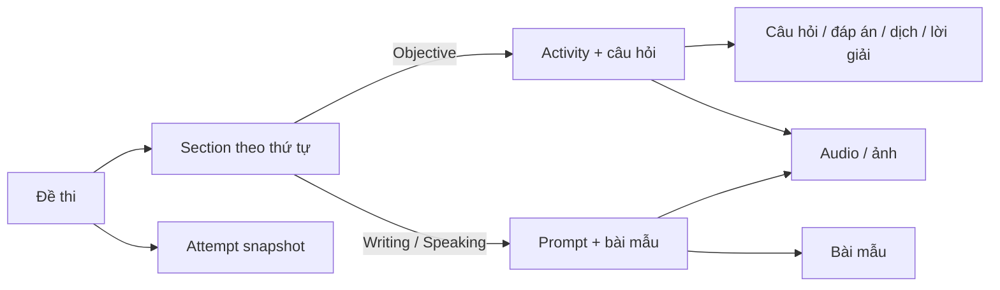

# Walkthrough quản trị đề thi B1

**Cập nhật:** 28/07/2026  
**Đối tượng:** Quản trị viên nội dung đề thi B1

Tài liệu này tóm tắt các chức năng B1 đã triển khai và hướng dẫn kiểm tra, tạo, chỉnh sửa, quản lý media và xuất bản đề. Mục tiêu là để admin quản lý đề bằng giao diện trực quan, không cần nhập JSON, HTML hoặc thao tác trực tiếp với cơ sở dữ liệu.

## Mục lục

1. [Phạm vi đã triển khai](#phạm-vi-đã-triển-khai)
2. [Khái niệm dữ liệu](#khái-niệm-dữ-liệu)
3. [Luồng quản trị đề B1](#luồng-quản-trị-đề-b1)
4. [Chọn cách học viên làm bài](#chọn-cách-học-viên-làm-bài)
5. [Quản lý media và TTS](#quản-lý-media-và-tts)
6. [Kiểm tra và xuất bản](#kiểm-tra-và-xuất-bản)
7. [Kiểm tra theo góc nhìn học viên](#kiểm-tra-theo-góc-nhìn-học-viên)
8. [Checklist kiểm thử phát hành](#checklist-kiểm-thử-phát-hành)
9. [Xử lý sự cố thường gặp](#xử-lý-sự-cố-thường-gặp)

## Phạm vi đã triển khai

Phase B1 đã hoàn thành nền tảng để một đề gồm nhiều kỹ năng và nhiều kiểu trình bày khác nhau vận hành trên cùng một hệ thống.

| Nhóm chức năng | Hiện có |
|---|---|
| Danh sách đề học viên | Xem đề đã xuất bản, thời gian, bắt đầu/làm tiếp/đóng attempt và lịch sử kết quả. |
| Làm bài | Một đồng hồ chung, điều chỉnh thời gian luyện tập, autosave, cảnh báo quá giờ nhưng vẫn cho làm tiếp. |
| Kết quả | Điểm theo từng phần, đáp án đúng/sai, dịch, lời giải, review câu viết lại, bài Writing/Speaking đã nộp. |
| Nội dung B1 | Đề B1 hiện xuất bản 13 section; Speaking chỉ giữ Topic 33 theo phạm vi hiện tại. |
| Admin builder | Tạo/gỡ/sắp xếp section, chọn kiểu trình bày, sửa nội dung, câu hỏi, đáp án, dịch/lời giải, preview. |
| Media | Upload audio/ảnh, tạo TTS, gắn media, xem usage, quản lý phiên bản và chặn xóa media đang được dùng. |
| Xuất bản | Checklist bắt buộc và publish gate ở cả client lẫn server. |

Các attempt đã bắt đầu giữ snapshot riêng. Vì vậy, khi admin sửa nội dung nguồn hoặc media của đề, bài người học đang làm và kết quả cũ không bị thay đổi.

## Khái niệm dữ liệu

- **Đề thi:** bộ điều phối, có thời lượng, trạng thái xuất bản và access tier.
- **Section:** một phần trong đề, ví dụ Listening Text 1 hoặc Writing Topic 7. Section quyết định thứ tự và kỹ năng.
- **Activity:** nội dung có câu hỏi chấm tự động, như trắc nghiệm, điền từ hoặc viết lại câu.
- **Prompt:** đề Writing/Speaking, nơi học viên viết bài hoặc chuẩn bị script.
- **Presentation (cách trình bày):** quyết định UI học viên thấy, form admin cần nhập và renderer đáp án. Không suy luận từ tên section.

## Luồng quản trị đề B1

### 1. Mở danh sách đề

1. Đăng nhập bằng tài khoản có quyền admin.
2. Mở [Quản lý Đề thi](/app/admin/exams).
3. Tìm đề B1 và chọn **Quản lý nội dung**.

Trang builder có ba vùng chính:

- Cột trái: danh sách section theo thứ tự; có nút lên/xuống để đổi thứ tự.
- Vùng giữa: chọn presentation, sửa nội dung và câu hỏi.
- Vùng preview: xem nhanh học viên sẽ làm bài và xem đáp án như thế nào.

### 2. Sửa một section có sẵn

1. Chọn section ở cột trái.
2. Kiểm tra **Cách học viên làm bài**.
3. Sửa các trường tương ứng: passage/prompt, câu hỏi, đáp án đúng, dịch và lời giải.
4. Xem hai preview: **Học viên làm bài** và **Học viên xem đáp án**.
5. Chọn **Lưu cách trình bày**.

Nếu section đã được dùng trong attempt trước đó, thay đổi này chỉ áp dụng cho attempt mới.

### 3. Thêm section mới

1. Trong builder, chọn **Thêm section**.
2. Nhập tên section, chọn kỹ năng và chọn **Cách học viên làm bài**.
3. Tạo section.
4. Hoàn thiện nội dung theo form chuyên biệt được hiển thị.
5. Bổ sung media, review và bài mẫu nếu presentation yêu cầu.
6. Lưu, preview và kiểm tra publish checklist.

### 4. Sắp xếp hoặc gỡ section

- Dùng nút mũi tên cạnh section để đổi thứ tự xuất hiện trong đề.
- Dùng nút gỡ để bỏ section khỏi đề. Hành động này chỉ gỡ liên kết với đề; nội dung gốc và attempt cũ vẫn được giữ.
- Khi xóa một câu hỏi trong section, hệ thống yêu cầu xác nhận. Chỉ xóa khi câu đó thực sự không còn cần dùng ở nội dung nguồn.

## Chọn cách học viên làm bài

Admin chọn presentation bằng nhãn dễ hiểu. Chỉ những trường phù hợp mới xuất hiện.

| Presentation | Dùng cho | Admin cần hoàn thiện | Học viên và kết quả |
|---|---|---|---|
| `choice_list` | Trắc nghiệm A–D | Câu hỏi, lựa chọn, một đáp án đúng, dịch, lời giải | Đáp án sai nền đỏ, đáp án đúng nền vàng và hiện toàn bộ nội dung lựa chọn. |
| `boolean_list` | Đúng/sai | Câu hỏi, hai lựa chọn, đáp án, review | Hiển thị câu hỏi theo danh sách. |
| `image_choice_list` | Signs/ảnh + lựa chọn | Ảnh, alt text, crop, câu hỏi/lựa chọn/review | Ảnh được hiển thị trước câu hỏi; kết quả vẫn cho biết lựa chọn sai/đúng. |
| `passage_questions` | Đọc/nghe đoạn văn + câu hỏi | Passage rich text và các câu hỏi bên dưới | Giữ định dạng passage an toàn, câu hỏi review từng thẻ. |
| `passage_text_inline` | Điền từ trực tiếp trong đoạn | Passage, gap và đáp án chấp nhận | Ô điền nằm trong đoạn; review đúng/sai theo gap. |
| `passage_choice_inline` | Cloze chọn A–D trong đoạn | Passage, gap, option và đáp án | Kết quả thay A/B/C/D bằng nội dung option thật trong đoạn. |
| `sentence_transformation` | Viết lại câu với từ khóa | Câu gốc, keyword, prefix/suffix, đáp án chấp nhận, normalization | So sánh theo token/ký tự nhưng vẫn giữ cụm từ dễ đọc; Enter chuyển câu kế tiếp. |
| `short_answer_list` | Danh sách câu trả lời ngắn | Prompt, đáp án chấp nhận, review | Enter chuyển ô tiếp theo, autosave. |
| `matching` | Ghép cặp | Danh sách hai cột và cấu hình ghép hợp lệ | Học viên ghép cặp; kết quả đối chiếu từng cặp. |
| `ordering` | Sắp xếp thứ tự | Các mảnh nội dung và đáp án thứ tự | Học viên sắp xếp; review cho thứ tự đúng. |
| `long_form_prompt` | Writing | Đề bài, hướng dẫn, TTS/audio tùy chọn, bài mẫu | Workspace viết, lưu tối đa 5 phiên bản, review và so sánh bài mẫu bỏ qua khác biệt định dạng. |
| `speaking_script_prompt` | Speaking chuẩn bị script | Đề, hướng dẫn, TTS/audio, bài mẫu script | Nhập và lưu script trước khi nói; review/compare tương tự Writing. |

### Quy tắc review bắt buộc cho nội dung chấm tự động

Mỗi câu objective nên có đủ:

- Đáp án đúng hoặc danh sách đáp án chấp nhận.
- Bản dịch tiếng Việt.
- Lời giải chi tiết.

Publish gate sẽ cảnh báo nếu các trường bắt buộc còn thiếu. Với câu viết lại, profile normalization được dùng để quy định dấu câu nào được bỏ qua và dấu câu nào phải tính là sai.

## Quản lý media và TTS

Mở [Media đề B1](/app/admin/exam-media). Đây là nơi quản lý audio Listening, TTS cho Writing/Speaking và ảnh Signs.

### Gắn audio hoặc TTS vào section

1. Chọn nội dung ở danh sách bên trái.
2. Chọn một trong ba cách:
   - tải file audio lên;
   - gắn URL audio ngoài;
   - tạo audio TTS từ nội dung của section/prompt.
3. Nghe preview trước khi lưu.
4. Xác nhận thay thế nếu section đã xuất bản.

TTS chỉ tạo được khi prompt/section có nội dung văn bản. Nếu chưa có nội dung, hãy hoàn thiện section trong builder trước.

### Gắn ảnh Signs

1. Mở nhóm Signs trong trang media.
2. Chọn biển báo tương ứng.
3. Upload ảnh.
4. Điền mô tả ảnh để hỗ trợ accessibility.
5. Chọn cách crop/hiển thị và kiểm tra preview.

### Thư viện media

Thư viện hiển thị mỗi asset kèm phiên bản và số nơi đang sử dụng.

- Có thể thay media để tạo version mới và giữ liên kết usage rõ ràng.
- Không thể xóa asset đang được dùng.
- Với file do hệ thống quản lý trong Storage, file chỉ bị xóa khi asset không còn usage.
- Attempt cũ vẫn sử dụng snapshot đã tạo; thay media không hồi tố kết quả cũ.

## Kiểm tra và xuất bản

### Readiness trước publish

Trong builder, khối readiness cho biết đề có thể xuất bản hay không. Các lỗi thường gặp:

| Cảnh báo | Cách xử lý |
|---|---|
| Section bắt buộc chưa có nội dung/câu hỏi | Hoàn thiện editor của presentation đó. |
| Câu hỏi thiếu đáp án đúng | Chọn đúng một đáp án hoặc thêm accepted answer. |
| Thiếu bản dịch/lời giải | Mở câu hỏi và điền translation/explanation. |
| Listening chưa có audio | Gắn audio trong Media đề B1. |
| Writing/Speaking thiếu đề/hướng dẫn/bài mẫu | Hoàn thiện prompt và thêm ít nhất một bài mẫu khi dùng so sánh mẫu. |
| Matching/ordering chưa hợp lệ | Hoàn thiện từng cặp hoặc thứ tự trong editor. |

### Xuất bản

1. Sửa toàn bộ issue trong readiness checklist.
2. Kiểm tra preview attempt và result của các section đã sửa.
3. Vào **Media đề B1** và chọn **Xuất bản đề B1**.
4. Hệ thống kiểm tra lại tại server trước khi đổi trạng thái xuất bản.

Không thể bỏ qua publish gate bằng cách sửa UI: server cũng kiểm tra section required, media, presentation config, review và bài mẫu bắt buộc.

## Kiểm tra theo góc nhìn học viên

Sau khi xuất bản, kiểm tra đề tại [Đề thi](/app/exams) bằng một tài khoản học viên.

### Làm bài

1. Mở đề B1 rồi chọn bắt đầu.
2. Chọn thời gian luyện tập nếu cần. Đồng hồ là đồng hồ chung toàn đề.
3. Làm từng section và kiểm tra autosave bằng cách tải lại trang rồi quay lại attempt.
4. Với `sentence_transformation` và `short_answer_list`, nhập câu trả lời rồi nhấn Enter để xác nhận focus chuyển xuống câu tiếp theo.
5. Với Writing/Speaking, viết bài/script, lưu checkpoint phiên bản và thử chuyển qua section khác rồi quay lại.
6. Khi hết thời gian, xác nhận có cảnh báo nhưng vẫn được tiếp tục làm.
7. Chọn **Nộp bài**. Attempt kết thúc và chuyển thẳng đến trang kết quả.

### Xem kết quả

Kiểm tra tại đường dẫn dạng `/app/exams/attempt/:attemptId/result`:

- Điểm tổng và điểm từng section rõ ràng.
- Lựa chọn sai có nền đỏ; lựa chọn đúng có nền vàng.
- Cloze inline hiển thị nội dung đáp án thay vì chỉ A/B/C/D.
- Câu objective có dịch và lời giải chi tiết.
- Sentence Transformation hiển thị khác biệt theo token/ký tự mà không làm vỡ chữ; phản hồi dấu câu theo normalization của câu.
- Writing/Speaking hiển thị bài nộp, các phiên bản đã lưu, bài mẫu và phần so sánh. So sánh bỏ qua khác biệt chỉ do dấu câu, dấu cách hoặc xuống dòng.

## Checklist kiểm thử phát hành

Làm checklist này sau bất kỳ thay đổi nội dung lớn nào.

- [ ] Tài khoản admin mở được `/app/admin/exams` và `/app/admin/exam-media`.
- [ ] Tạo một section nháp thuộc presentation cần dùng, hoàn thiện nó rồi gỡ khỏi đề thử nghiệm.
- [ ] Đổi thứ tự hai section và xác nhận thứ tự ở attempt mới.
- [ ] Sửa một câu trắc nghiệm: đáp án đúng, dịch và lời giải đều hiển thị đúng ở result.
- [ ] Thử một passage inline và xác nhận option text, không phải A/B/C/D, xuất hiện ở result.
- [ ] Thử Transformation với một khác biệt dấu câu đúng theo normalization đã chọn.
- [ ] Upload audio và ảnh Signs; kiểm tra preview, alt text/crop và usage count.
- [ ] Tạo TTS cho một prompt đã có nội dung; nghe audio ở media và ở attempt.
- [ ] Xác nhận asset đang được sử dụng không có thao tác xóa khả dụng.
- [ ] Publish đề, bắt đầu attempt mới và đi hết 13 section hiện xuất bản.
- [ ] Nộp bài, kiểm tra điểm từng phần và Writing/Speaking review.
- [ ] Sửa source sau khi đã có attempt rồi mở lại attempt cũ để xác nhận snapshot cũ không đổi.

## Xử lý sự cố thường gặp

### Trang Media đề B1 không tải nội dung

Tải lại cứng bằng `Ctrl + Shift + R`. Nếu vẫn lỗi, mở F12 → Network và kiểm tra request Supabase.

Trang media hiện tải dữ liệu theo chuỗi `đề B1 → section → resource`, vì `resource_id` của section là liên kết đa hình. Không dùng join lồng trực tiếp qua `resource_id` trong PostgREST. Nếu thấy `400` từ request `exam_sections` hoặc `practice_questions`, gửi phần response body cho đội phát triển.

Thông báo React DevTools chỉ là thông báo môi trường development. Lỗi từ file extension như `onboarding.js` không thuộc MemoryLang; hãy thử cửa sổ ẩn danh không extension để tách lỗi trình duyệt khỏi ứng dụng.

### Không thấy trang admin

`/app/admin/*` chỉ dành cho profile có `is_admin`. Tài khoản học viên sẽ được chuyển về dashboard và không gửi request tải dữ liệu admin.

### Không thể xuất bản

Đọc từng issue trong readiness checklist. Không nên tự sửa dữ liệu trong database để bỏ qua vì publish RPC sẽ kiểm tra lại ở server.

### Không tạo được TTS

Điền nội dung đề/prompt trước. TTS cần văn bản nguồn để tạo audio. Sau đó kiểm tra cấu hình TTS trong khu vực admin và thử preview.

## Tài liệu liên quan

- [Kế hoạch kiến trúc và trạng thái triển khai B1](../superpowers/plans/2026-07-28-b1-exam-admin-content-architecture.md)
- [Trang danh sách đề](/app/exams)
- [Quản lý đề thi](/app/admin/exams)
- [Media đề B1](/app/admin/exam-media)
